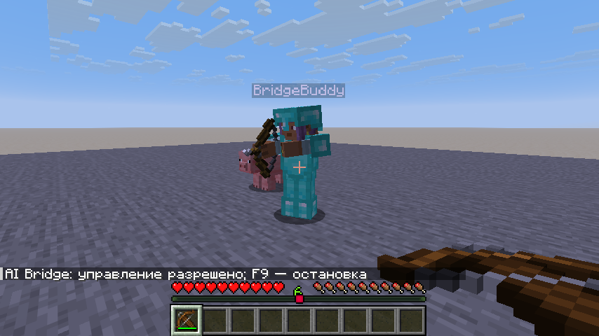

# Minecraft AI Bridge

Мод для **Minecraft 26.1.2 / NeoForge 26.1.2.97**, связывающий твоего игрока или отдельного компаньона с внешним контроллером через WebSocket. Внешний ИИ выбирает цели; мост выполняет их по игровым тикам и возвращает фактический результат.

Модель **Gemma 4 E2B IT** запускается через **vLLM TPU в Google Colab**, Minecraft и Python-контроллер — на Windows. Цели задаются прямо из игры. Порядок запуска: [единый гайд для Windows](docs/INGAME_VLLM_RU.md). Результаты проверок: [docs/VALIDATION.md](docs/VALIDATION.md).

## Скачать готовый мод

[Скачать minebridge-0.19.0.jar](https://github.com/Cloudeah/minebridge/blob/main/releases/minebridge-0.19.0.jar) кнопкой **Download raw file**. SHA-256: `a67213e44ffc8cf4f2c3571f28ae803ec12e3a1fdf99154c0588b37b0bba406d`. Перед установкой удалите предыдущую версию minebridge из папки `mods`.

Нужны **Minecraft 26.1.2**, **NeoForge 26.1.2.97** и **Java 25**. Скопируйте JAR в папку `mods` клиента, откройте одиночный мир и используйте F8 для разрешения управления, F9 для остановки. Настройка внешнего контроллера описана ниже.

## Модель и управление из игры

[Notebook vLLM TPU](examples/vllm_tpu_colab.ipynb) создаёт отдельное окружение Python 3.12 с `vllm-tpu==0.31.0`, запускает модель и подключается к [Windows-контроллеру](examples/vllm_colab.py). HTTPS-туннель ngrok работает на Windows; сервер модели остаётся локальным внутри Colab. В [гайде](docs/INGAME_VLLM_RU.md) описаны установка, Colab Secrets, проверка соединения, PNG-зрение и исправление ошибок.

**F7** открывает окно целей: текст, число шагов (по умолчанию 8), PNG-зрение, запуск, остановка, текущая задача и подтверждённый прогресс, включая тики сопровождения, взаимодействия, зарядки арбалета, выстрелы, попадания, урон, перестановки и экипировку. **F8** разрешает управление, **F9** останавливает его. Мод отклоняет запоздалые решения после ручного вмешательства и новой цели. Один шаг модели может быть целой игровой задачей: например, десять прыжков с `move.jump` и `count: 10`.

В **0.16.0** появился отдельный **компаньон в одиночном мире**. **F6** создаёт персонажа, включает самостоятельные цели, убирает с сохранением и возвращает его; здесь же выбирается, кем управляют F7/F8. Компаньон имеет свой UUID, инвентарь, здоровье, еду, урон и обычную физику. Без явной цели он исследует и выживает через vLLM; еда, всплытие и отход при критическом здоровье выполняются локальными реакциями, пока управление разрешено. Твои клавиши и камера не прерывают его. **F9 останавливает оба исполнения**.

В **0.17.0** компаньон быстро защищает тебя и себя от действительно нападающих мобов, выбирает оружие из своего инвентаря и переключается на угрозу владельцу. При критическом здоровье он отходит, даже если ты рядом. **F6 → «Быстрая защита»** включает эту реакцию отдельно от самостоятельных целей; настройка сохраняется в мире. Нужны подключённый контроллер и разрешение F8; F9 прекращает бой. Попадания, урон и поражение цели подтверждаются сервером и передаются модели.

В **0.18.0** компаньон в самостоятельном режиме надевает броню из своего инвентаря в пустые ячейки и возвращается ближе, когда вы разошлись больше чем на 24 блока. Он сохраняет уже надетые вещи и пропускает броню с проклятием несъёмности. Возвращение идёт обычным маршрутом к движущемуся владельцу, без телепортации; бой, голод и F9 могут его прервать. Явная цель из F7 имеет приоритет над этими двумя бытовыми реакциями.

В **0.19.0** компаньон стреляет из лука и арбалета по решениям vLLM. Выстрел использует реальные стрелы и обычную зарядку; подтверждённый выпуск, попадание, урон и поражение цели учитываются отдельно. F9 и потеря связи останавливают зарядку без выстрела. Заряженную стрелу можно сохранить и выпустить новой задачей. Готовый мод, Windows-контроллер и notebook нужно обновить вместе.

Начни с [раздела про компаньона в Windows-гайде](docs/INGAME_VLLM_RU.md#компаньон-в-одиночном-мире). Контроллеру нужен `--companion`: WebSocket компаньона — **8767**, прежний HTTP-relay/ngrok — **8766**. В Colab шаг 6 с `DECISIONS = 0` принимает решения постоянно. PNG у компаньона пока недоступен. После смерти он возрождается кнопкой F6 по правилам мира; вещи сохраняются только при соответствующем gamerule. При возрождении, скрытии/возврате или смене измерения перезапусти контроллер и разреши F8.



План строительства объединяет части vanilla-дверей и кроватей: один предмет на установку, правильная последовательность и поворот, проверка обеих клеток. Вторую часть можно не перечислять. Исполнитель отходит из клеток постройки перед размещением; столкновение с сущностью выявляется до клика. Серверные подтверждения и частичный прогресс сохраняются.

В **0.12.0** ближний бой поддерживает `hits: 1..64`: задача заканчивается после заданного числа серверных попаданий либо более раннего поражения цели. Без `hits` сохраняется бой до поражения. Погоня ограничена расстоянием от исходной позиции; каждый удар ждёт своего подтверждения, а непроверяемый эффект не вызывает повторную атаку.

Добыча выбирает подходящий инструмент из main inventory по возможности получить дроп и базовой скорости. При равной скорости сохраняется выбранная рука, затем учитывается остаток прочности. Добыча подтверждается серверным событием этого игрока и фактическим состоянием блока после него. Внешнее удаление блока и уже пустая ячейка не добавляют добытый блок. Дроп и его подбор подтверждаются отдельно; пауза останавливает незавершённую добычу без автоматического повторения.

## Сборка и запуск

Нужны JDK 25 и доступ к Maven Central, Maven NeoForge и официальным ресурсам Minecraft. Gradle 9.2.1 включён; дистрибутив проверяется по SHA-256.

```bash
./gradlew :core:test :mod:build
./gradlew :mod:runClient
```

Мод: `mod/build/libs/minebridge-0.19.0.jar`. Установите его в `mods` клиента с указанной версией NeoForge. Java-WebSocket вложен в JAR; Gson предоставляется Minecraft.

В облачной среде: `python scripts/dev.py :core:test :mod:build`. Помощник находит JDK 25 в `/workspace/toolchains`, использует штатный прокси и системное хранилище доверенных сертификатов. Графическому клиенту нужен дисплей OpenGL; звуковое устройство не требуется.

1. Откройте одиночный мир. Мод создаст `config/minebridge/bridge-owner.json` с случайным токеном и портом 8765. В dev-запуске файл находится под `mod/run/`.
2. Подключитесь к `ws://127.0.0.1:8765/bridge`, выполните `session.hello` и `session.authenticate`.
3. **F8** разрешает управление. **F9** — независимая аварийная остановка. Клавиши можно переназначить.
4. После остановки снова нужен F8. Ручные клавиши, кнопки мыши и изменение взгляда приостанавливают текущую задачу; игровое меню также ставит её на паузу.

Токен не печатается в журнал и capabilities. Права файла на POSIX — `0600`; не добавляйте его в Git. Мост слушает только loopback, отклоняет браузерный Origin. Для удалённого ИИ используйте SSH-туннель или аутентифицированный шлюз WSS.

## Внешний клиент

Python 3.11+:

```bash
python -m venv .venv
.venv/bin/pip install -r python/requirements.txt
.venv/bin/python examples/client.py snapshot
.venv/bin/python examples/client.py craft-plan minecraft:stick 4
.venv/bin/python examples/client.py move 10 64 20
.venv/bin/python examples/client.py vision scene
.venv/bin/python examples/client.py stop
```

`vision scene` сохраняет PNG, JSON и depth float32 little-endian. Захват мира выполняется до рук и HUD. Для обычного запуска передайте `--config /путь/к/config/minebridge/bridge-owner.json`; токен читается из файла.

```python
from minebridge_client import BridgeClient

async with BridgeClient.from_owner_file("config/minebridge/bridge-owner.json") as bridge:
    state = await bridge.request("observe.snapshot")
    accepted = await bridge.submit("move.to", {
        "target": {"x": 10, "y": 64, "z": 20}, "tolerance": 0.7
    }, timeout_ticks=1200, max_actions=10000)
    result = await bridge.wait_task(accepted["task_id"])
```

## Поддержанные механики

| Область | Реализация и ограничения |
| --- | --- |
| Сессия | Один актор и контроллер на endpoint: твой игрок либо компаньон; версия, токен, capabilities, ping и resume |
| Наблюдение | Игрок, инвентарь, открытое меню, видимые сущности/блоки и предметы в руках/на земле; revision, время, тик, подписки |
| Видимость | Лучи движка; закрытые контейнеры не читаются. Телеметрия включается владельцем |
| Задачи | accepted → queued → running / paused; succeeded / failed / cancelled; приоритет, зависимости, срок и бюджет |
| Маршруты | Ограниченный A*, ходьба, бег, прыжок на один блок; проверка пространства перехода, перепланирование и обнаружение застревания; сопровождение сущности с ограниченным временем рядом с целью |
| Простые движения | Движение относительно взгляда, приседание, движение пригнувшись, относительный поворот, 1–30 прыжков на месте |
| Бой | Ближняя атака до поражения или заданного числа попаданий, ограниченная погоня, серверные receipts урона; один выстрел из обычного лука либо из арбалета с одной обычной стрелой по видимой живой неигровой цели без преследования; нужно оружие в основной руке; лук использует стрелы по vanilla-правилам, арбалет — одну обычную стрелу; атака игроков отключена |
| Предметы | Выброс выбранного предмета, подбор наблюдаемого выпавшего предмета, использование предмета в основной/второй руке с подтверждением сервера |
| Блоки | Штатная добыча с проверкой инструмента; `block.place` и строительство сами подготавливают материал из инвентаря, проверяют опору и свойства |
| Инвентарь | Осмотр, выбор предмета из основной части инвентаря в hotbar, точный перенос количества между слотами текущего меню, перестановка целых стопок и экипировка с сохранением прежнего предмета |
| Карта/память | Поиск ближайших блоков и записей с фильтром свежести, происхождением, world/dimension и пометками ИИ; подтверждённое изменение блока обновляет память фактическим состоянием |
| Крафт | Цепочки shaped/shapeless, альтернативы ингредиентов/рецептов, выходы, остатки, станции, серверное подтверждение |
| Строительство | Поворот, материалы/конфликты, составные vanilla-двери и кровати, подход и отход игрока, размещение, частичный результат, финальная проверка всех клеток |
| Зрение | PNG + нативная глубина одного framebuffer, камера, связанный снимок, объекты, crop и поток |
| Разрыв связи | Освобождение управления, пауза задач, история и результаты; явное возобновление |

Для крафта 3×3 подходит уже открытый верстак или ближайший видимый верстак в пределах взаимодействия. Мод может открыть его одним действием, но не подходит к нему автоматически. Сырьё не добывается автоматически. Каталог берётся со встроенного сервера; динамические, компонентно-зависимые и машинные рецепты не поддерживаются. `count` — целевое количество предмета в инвентаре, а не безусловное дополнительное производство.

Строительство сохраняет существующие блоки. Для замены нужна отдельная `block.break`; `replace=true` отклоняется. `block.place` и `build.execute` подготавливают нужный материал из main inventory в hotbar штатным SWAP; если для этого нужен SWAP, открытый контейнер требуется закрыть. Не каждое сочетание свойств достижимо штатным размещением: неподтверждённая ориентация возвращает ошибку с фактическим состоянием, без автоматического удаления блока. Двери и кровати подтверждаются по всем частям; выход любой части за разрешённую область отменяет всю установку. Уже совпадающая клетка не расходует материал или клик. Чертёж ограничен 4096 блоками.

Взаимодействия связывают серверный клик с новой открытой формой, изменением блока, предмета в выбранной руке или поддержанным состоянием животного. Кормление подтверждает взаимодействие, но не рождение детёныша. `container.open` успешен только при открытии нового меню; непроверяемые эффекты дают `interaction_unconfirmed`. Не реализованы полноценные маршруты плавания/полёта, арбалетный Multishot и фейерверки, трезубцы, прочие типы дальнобойного оружия и баллистика в воде, автоматические жидкости/энергия/машины, произвольные интерфейсы модов и плотная карта ID пикселей. Они не объявляются в capabilities. Маршруты не загружают чанки и не изменяют мир для прохода.

`item.drop` выбрасывает только выбранный предмет основной руки (hotbar), отдельными обычными действиями; частичный результат сообщает подтверждённое количество. `item.pickup` подбирает весь стак наблюдаемого `minecraft:item` обычным движением игрока и подтверждается сервером для этого игрока и UUID предмета; если инвентарь заполнен, результат содержит собранное и оставшееся количество. Исчезновение сущности само по себе не подтверждает подбор. `item.use.target`, если передан, только направляет камеру: для нажатия на блок или сущность используйте `world.interact`. Использование подтверждается серверным состоянием, счётчиком использования или изменением предмета; неизменившийся предмет не означает, что предмет был съеден или попал в цель.

## Настройки владельца

В `bridge-owner.json`: `port`, `radius` (1–24), `telemetry` (false по умолчанию), `allowedActions` (пустой список разрешает поддержанные действия), `areas`. Capabilities содержит доступные действия и отдельный список `queries`. Модельные queries позволяют запросить маршрут, карту/память, план крафта/строительства или осмотр инвентаря до выполнения соответствующей задачи. Пример области:

```json
{"dimension":"minecraft:overworld","minX":-32,"minY":0,"minZ":-32,"maxX":32,"maxY":128,"maxZ":32}
```

Области проверяются для движения, боя, блоков и каждой позиции чертежа. Меняйте файл при закрытом мире. На внешнем сервере клиентский мост предоставляет наблюдение без управляемых действий.

На выделенном сервере администратор выполняет `/minebridge observe <player>` для структурной сессии и `/minebridge stop` для её закрытия. Зрение и действия в этом адаптере недоступны. Токен в серверном файле владельца; доступ локальный. Выбор игрока повторяется после перезапуска.

## Документация и структура

- [API и бинарный формат](docs/API.md)
- [Архитектура](docs/ARCHITECTURE.md)
- [Проверки и приёмка](docs/VALIDATION.md)
- `core/` — независимое ядро, планировщики, тесты
- `mod/` — интеграция NeoForge и нативный захват
- `python/` — async клиент и HTTP-relay; `examples/` — контроллер vLLM, TPU notebook, CLI и чертёж

Журнал: `logs/minebridge-events.jsonl`, с ротацией. Изображения и токены не журналируются. Память: `config/minebridge/bridge-memory/`; ID мира — `minebridge-world-id.txt` в сохранении.

Компаньон хранится в `<мир>/minebridge-companion.dat` (профиль и NBT персонажа одним атомарно заменяемым файлом, предыдущая копия `.bak`). Его журнал — `logs/minebridge-companion-events.jsonl`, память — отдельный подкаталог `bridge-memory/companion-<UUID>/`, чтобы параллельные акторы не перезаписывали друг друга. Повреждённое сохранение не заменяется новым персонажем.

Компаньон — серверный игрок с автоматическим управлением и признаком `isFakePlayer`; это первая версия для одиночного мира. Некоторые моды, квесты, машины и системы прав требуют настоящего сетевого клиента и могут его не поддерживать. Полное прохождение произвольной сборки и неотличимость от человека не заявляются.
