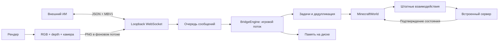

# Архитектура

Сеть не читает/меняет мир. Engine принимает сообщения и выполняет одну задачу в игровом тике, сериализуя движение, взгляд, руки и интерфейс. Cancel/stop обрабатываются первыми. Повтор команды возвращает прежнее подтверждение; задача хранит один терминальный результат.

Клиент использует KeyMapping и MultiPlayerGameMode. Нет телепортации, выдачи предметов, прямого setBlock или мгновенного уничтожения. Блоки/меню/количество предметов подтверждаются заданиями на потоке встроенного сервера. Непроверяемый эффект не объявляется успехом.

Планировщики независимы от Minecraft: A* исключает UNKNOWN, крафт использует виртуальный инвентарь и откат альтернатив, строительство поворачивает/сортирует чертёж. Адаптер связывает их с коллизиями, рецептами и реальными интерфейсами.

Нативный захват снимает цвет/depth после мира из одного OpenGL framebuffer; PNG кодируется отдельно. Одновременных захватов нет. Видеовыход хранит последний кадр. Синхронное GPU-readback требует измерения на пользовательской сборке; гарантии FPS/TPS не заявляются.

Память разделяется по постоянному ID сохранения и измерению; неизвестные клетки не заполняются воздухом. Сохранённая запись не считается актуальной. Файл по возможности заменяется атомарно.

Лимиты: 128 входных сообщений, 256 управляющих сообщений на соединение, 512 событий, 256 задач, 4096 дедуплицированных запросов/10 минут, 20000 блоков, 2000 пометок. Переполнение результатов не скрывается: соединение закрывается и клиент получает историю/снимок. Снимки полные; компактный протокол block/entity deltas ещё не введён.

DedicatedBridge даёт администратору структурный режим. Изображения/действия требуют клиентского исполнителя. Публикация среды сохраняет файлы, но не процессы и соединения.
