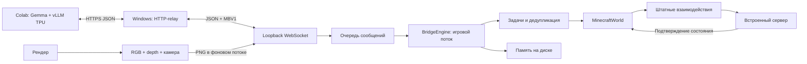

# Архитектура

Сеть не читает/меняет мир. Engine принимает сообщения и выполняет одну задачу в игровом тике, сериализуя движение, взгляд, руки и интерфейс. Cancel/stop обрабатываются первыми. Повтор команды возвращает прежнее подтверждение; задача хранит один терминальный результат.

Windows-контроллер в `examples/vllm_colab.py` принимает цели из окна F7 через `model.claim`, запрашивает компактное наблюдение и получает проверенное JSON-решение из Colab. HTTP-relay в `python/colab_relay.py` авторизует notebook отдельным токеном; этот токен не попадает в запрос модели. vLLM слушает loopback внутри Colab. У заданий relay есть ID и срок: повтор доставки возвращает тот же результат, запоздалый ответ отменённого задания отклоняется. Перед игровой задачей контроллер передаёт `control_epoch` и `model_goal_id`, чтобы мод отклонил решение после ручного вмешательства, остановки или смены цели.

Клиент использует KeyMapping и MultiPlayerGameMode. Нет телепортации, выдачи предметов, прямого setBlock или мгновенного уничтожения. Блоки/меню/количество предметов подтверждаются заданиями на потоке встроенного сервера. Непроверяемый эффект не объявляется успехом.

MiningTools сравнивает пригодность и базовую скорость наблюдённых инструментов; MinecraftWorld подготавливает точный экземпляр и сверяет полную серверную стопку до добычи. MiningLedger связывает BreakBlockEvent с активной задачей этого игрока и ячейкой, затем проверяет итоговую отмену события и фактическую замену блока в очереди сервера. Между потоками передаются копии записей под синхронизацией. Простое исчезновение блока не создаёт подтверждение; подбор выпавшего предмета остаётся отдельной задачей. Пауза прекращает частичную добычу без повторной отправки, а уже записанное подтверждение сохраняется в терминальном результате и памяти.

MeleeSequence разрешает один неподтверждённый удар и ждёт соответствующего CombatLedger receipt. Явный `hits` завершает серию по подтверждённым попаданиям; без него сохраняется цель поражения. Непроверенный удар не повторяется после тайм-аута или паузы. Перед новым воздействием адаптер проверяет серверные дистанцию до формы цели, видимость, cooldown, руку и состояние игрока. Погоня использует штатный маршрут и общий бюджет; её радиус фиксируется от начальной серверной позиции, а подтверждённый урон сохраняется при ошибке или отмене.

Взаимодействия связываются с серверными PlayerInteractEvent по игроку, измерению, цели и руке. Очередь встроенного сервера снимает результат после завершения штатной обработки пакета, без клиентского предсказания. Счётчик появляется только при новой форме или поддержанном изменении блока/сущности/предмета. Пауза прекращает ожидание незавершённого подтверждения, а зафиксированный результат сохраняется. В компактном наблюдении цель текущей задачи и разные полезные типы сущностей имеют приоритет над снарядами.

Выброс отправляется по одному через LocalPlayer.drop и сверяется с серверным количеством основной руки. Подбор выполняется обычным движением; серверные callbacks фиксируют точного игрока/UUID и результат естественного подбора. Для частичной вставки без итогового события сопоставляются уменьшение того же стака и равный прирост инвентаря в том же серверном тике. Между серверным и клиентским потоком передаются ограниченные синхронизированные записи; callbacks не вызывают клиентское управление.

Использование предмета удерживает KeyMapping до естественного окончания или срока. Перед обработкой клавиш Minecraft кнопка отпускается, когда использование закончено, чтобы не запустить следующий предмет. Результат различает наблюдённое сервером использование, счётчик использования и изменение предмета в руке. При исчерпанном бюджете WorldAccess.awaitingConfirmation допускает только чтение/отпускание уже отправленного действия; новые мутации запрещены, а исходный срок и остановка владельцем сохраняются.

Относительное движение фиксирует цель по начальному yaw и использует тот же A*, что движение к абсолютной точке. Прыжки считаются только после серверной пары «отрыв → приземление»; приседание — по серверным тикам с подтверждённым отпусканием. Достижение точки и относительный поворот также проверяются сервером. Переключаемые клавиши приседания/бега не остаются включёнными после освобождения управления.

Планировщики независимы от Minecraft: A* исключает UNKNOWN, крафт использует виртуальный инвентарь и откат альтернатив, строительство поворачивает/сортирует чертёж. Адаптер связывает их с коллизиями, рецептами и реальными интерфейсами.

Нативный захват снимает цвет/depth после мира из одного OpenGL framebuffer; PNG кодируется отдельно. Одновременных захватов нет. Видеовыход хранит последний кадр. Синхронное GPU-readback требует измерения на пользовательской сборке; гарантии FPS/TPS не заявляются.

Память разделяется по постоянному ID сохранения и измерению; неизвестные клетки не заполняются воздухом. Сохранённая запись не считается актуальной. Файл по возможности заменяется атомарно.

Лимиты: 128 входных сообщений, 256 управляющих сообщений на соединение, 512 событий, 256 задач, 4096 дедуплицированных запросов/10 минут, 20000 блоков, 2000 пометок. Переполнение результатов не скрывается: соединение закрывается и клиент получает историю/снимок. Для модели используется компактный профиль наблюдения, а полный профиль остаётся доступен SDK; протокол block/entity deltas ещё не введён. Права `allowedActions` владельца учитываются при публикации capabilities и при принятии игровых действий/запросов планировщиков.

DedicatedBridge даёт администратору структурный режим. Изображения/действия требуют клиентского исполнителя. Публикация среды сохраняет файлы, но не процессы и соединения.
