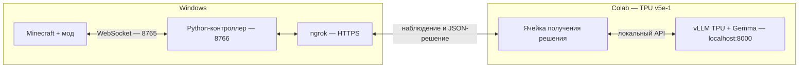
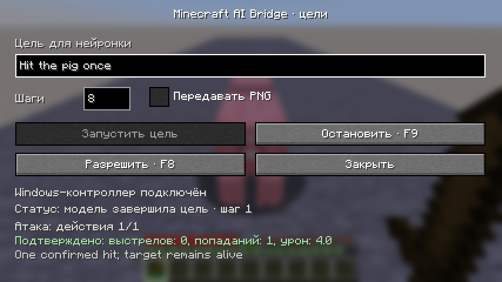
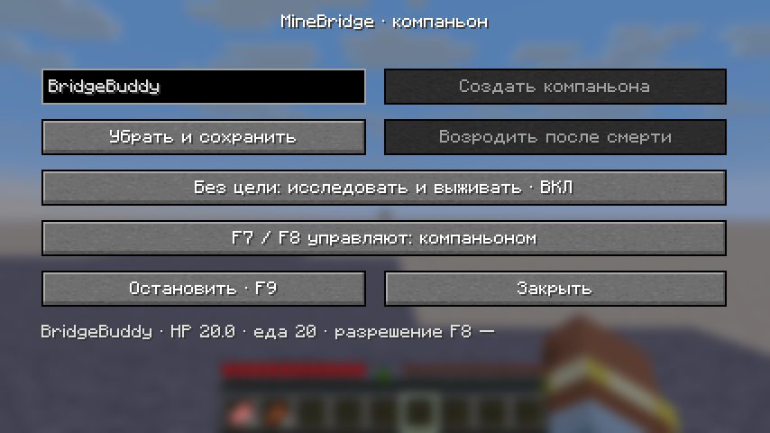

# Minecraft AI Bridge + vLLM TPU — Windows

Minecraft и Python-контроллер работают на твоём компьютере, **Gemma 4 E2B IT** — через **vLLM TPU в Google Colab**. Цель вводится в окне **F7**. Контроллер передаёт наблюдение модели, проверяет решение и отправляет задачу моду; результат берётся из игры.





## 1. Подготовь или обнови Windows

1. Нужны **Minecraft 26.1.2**, **NeoForge 26.1.2.97**, **Java 25**, **Python 3.12**.
2. Закрой Minecraft. Скачай [minebridge-0.19.0.jar](https://github.com/Cloudeah/minebridge/blob/main/releases/minebridge-0.19.0.jar) кнопкой **Download raw file**. Удали предыдущую версию minebridge из папки `mods` и положи новый JAR. Для стандартного launcher папка — `%APPDATA%\.minecraft\mods`.
3. Скачай свежий **Code → Download ZIP** [репозитория](https://github.com/Cloudeah/minebridge), распакуй в `C:\minebridge`. В этой папке должны оказаться `examples`, `python` и `releases`, без дополнительной вложенной папки `minebridge-main`. При обновлении замени Python-контроллер и notebook свежими файлами, сохранив свой `.minebridge-colab.json`. Для уже открытого Colab загрузить новый notebook, повторить шаги 4 и 6.
4. Открой PowerShell и установи зависимости:

```powershell
cd C:\minebridge
py -3.12 -m venv .venv
.\.venv\Scripts\python.exe -m pip install -r python\requirements.txt
```

Если `py -3.12` пишет `No suitable Python runtime found`, Python 3.12 ещё не найден launcher. Проверь `py --list`, установи [Python 3.12.10 для Windows](https://www.python.org/downloads/release/python-31210/) вместе с launcher, открой новый PowerShell и повтори команду. Уже созданное рабочее окружение `.venv` повторно создавать не нужно.

5. Запусти профиль NeoForge, открой одиночный мир. Нажми **F3+P**, чтобы игра продолжала работать при переключении окон, и закрой меню Escape. Мод создаст `config\minebridge\bridge-owner.json` в игровой папке.
6. Проверь соединение:

```powershell
.\.venv\Scripts\python.exe examples\client.py --config "$env:APPDATA\.minecraft\config\minebridge\bridge-owner.json" snapshot
```

Ожидается JSON состояния. Если launcher использует другую игровую папку, подставь её путь к `bridge-owner.json` во всех командах этого гайда.

7. Создай аккаунт [ngrok](https://ngrok.com/), скачай Windows-версию в `C:\ngrok` и один раз добавь authtoken из dashboard:

```powershell
C:\ngrok\ngrok.exe config add-authtoken "ТВОЙ_AUTHTOKEN_NGROK"
```

Для соединения достаточно одного HTTPS-адреса: он доступен и на бесплатном тарифе ngrok. У Free есть [лимиты трафика и запросов](https://ngrok.com/docs/pricing-limits/free-plan-limits); платная подписка для первого запуска не обязательна. Полный путь `C:\ngrok\ngrok.exe` работает независимо от настройки PATH.

## Компаньон в одиночном мире

1. Обнови **JAR, Python-контроллер и notebook** до версии 0.19.0. В этом выпуске компаньон поддерживает дальний бой, а notebook сохраняет обязательные сведения при сокращении контекста. Запусти одиночный мир, освободи безопасную площадку рядом с собой и открой **F6**. Введи имя (1–16 латинских букв, цифр или `_`) и нажми **Создать компаньона**. Читы для этого не нужны. В мире допускается один такой персонаж.
2. В F6 оставь **«Самостоятельные цели: ВКЛ»**, **«Быстрая защита: ВКЛ»** и **«F7 / F8 управляют: компаньоном»**. Персонаж появляется без бесплатных предметов. Передай ему еду и инструменты, выбросив их рядом: он подбирает вещи по обычным правилам.
3. В команде запуска контроллера из шага 3 добавь **`--companion`**. Полная команда:

```powershell
cd C:\minebridge
.\.venv\Scripts\python.exe examples\vllm_colab.py `
  --config "$env:APPDATA\.minecraft\config\minebridge\bridge-owner.json" `
  --relay-config C:\minebridge\.minebridge-colab.json `
  --interactive --companion --task-ticks 800
```

Контроллер автоматически выбирает **`port + 2`** из файла владельца: по умолчанию **8767**. Токен Minecraft прежний. HTTP-relay остаётся на **8766**, поэтому команда ngrok и HTTPS/token в Colab остаются прежними. Останови прежний контроллер перед запуском нового: одновременно два процесса не могут слушать один relay-порт.

4. Выполни шаги Colab по порядку. В шаге **6** оставь **`DECISIONS = 0`**, **`KEEP_READY_BETWEEN_GOALS = True`**. Ячейка работает непрерывно, пока её не остановишь; ограничения длительности самой сессии Colab сохраняются.
5. Вернись в Minecraft, нажми **F8**. Компаньон начнёт ставить себе циклы целей: осматриваться, добывать еду и ресурсы, крафтить и исследовать рядом с владельцем. Цели ограничены восемью решениями за цикл и игровыми бюджетами; модель может ошибаться. Еда при голоде и реакции на опасность могут прервать старое решение и запросить новое наблюдение. Реакции также соблюдают разрешённые действия и области владельца.
6. **F7** задаёт твою цель компаньону и прерывает его текущий план. Можно свободно двигаться и поворачивать свою камеру. **F9** останавливает задачи обоих акторов, самостоятельные цели и локальные реакции. Для нового запуска снова нужен F8. Физика, голод и урон мира продолжают действовать.
7. В **F6** можно отключить самостоятельные цели, сохранив работу по твоим целям; убрать персонажа с сохранением инвентаря; вернуть его или возродить после смерти. Возрождение использует кровать/якорь или обычную точку мира; без `keepInventory` прежние вещи остаются дропом. Компаньон не телепортируется за владельцем и не получает бессмертие. Движение ограничено 64 блоками от владельца в том же измерении; если владелец ушёл дальше, разрешено приближаться к нему.
8. После **возрождения, скрытия/возврата, перехода компаньона в другое измерение или перезахода в мир** перезапусти Windows-контроллер. При незавершённой задаче после разрыва сначала F9, затем F8. Существующее сохранение персонажа загрузится с тем же UUID и инвентарём.



**Броня и возвращение в 0.18.0.** Включи в F6 «Самостоятельные цели», подключи контроллер и разреши F8. Выбрось рядом броню: после обычного подбора компаньон сам заполнит пустые ячейки головы, груди, ног и ступней. Сравниваются базовые очки брони, затем твёрдость и остаток прочности; уже надетая вещь остаётся на месте. Проклятие несъёмности исключено. Поддерживается обычная экипировка Minecraft; предмет другого мода должен объявлять стандартные компоненты экипировки и брони, совместимость всей сборки не проверена. Чары защиты при выборе пока не сравниваются. При открытом контейнере или предмете на курсоре переодевание не запускается.

Если ты ушёл больше чем на 24 блока, компаньон может вернуться на расстояние около шести блоков и подождать там одну секунду. Нужны видимость владельца, общее измерение, расстояние не больше 96 блоков и проходимый маршрут по загруженным клеткам. Сквозь стены, за пределы локального маршрута и между измерениями он не телепортируется. Бой, еда и F9 прерывают возвращение. После потери связи незавершённая задача остаётся на паузе до явного возобновления или новой цели. Выключение самостоятельности отключает обе бытовые реакции; явная активная цель F7 также имеет приоритет над ними.

**Быстрая защита в 0.17.0.** Пока контроллер подключён и разрешено F8, компаньон помогает при атаке моба на тебя или на него самого. Учитываются текущая цель моба и подтверждённый урон за последние десять секунд. Цель должна быть видна и находиться в пределах 12 блоков от компаньона; для защиты владельца — также в пределах 12 блоков от тебя. Игроки, союзники и ваши приручённые питомцы исключены. Само присутствие враждебного моба рядом не запускает эту реакцию.

Он прерывает ожидание модели или текущую задачу, подготавливает оружие из своего инвентаря по базовому урону и скорости атаки, подходит обычным движением и ждёт серверного подтверждения каждого удара. Помощь владельцу имеет приоритет перед самозащитой. Один бой ограничен десятью секундами и 16 действиями, погоня — 12 блоками от исходной позиции; разрешённые действия и области владельца продолжают действовать. При здоровье 6 или ниже он пытается отойти к доступной безопасной точке, увеличивающей расстояние от угрозы. Это не гарантирует спасение в окружении или непроходимом месте.

**F6 → «Быстрая защита: ВЫКЛ»** отключает именно эту локальную реакцию. Она работает и при выключенных самостоятельных целях. Модель по-прежнему может выбирать бой по твоей цели или при поиске еды. Переключение прерывает текущий план; для полной остановки используй F9. Настройка сохраняется после выхода, скрытия и возвращения персонажа; при обновлении с 0.16.0 она включена по умолчанию, UUID и вещи сохраняются.

**Лук и арбалет в 0.19.0.** Передай компаньону оружие и стрелы обычным выбрасыванием рядом. Закрой его открытый контейнер, разреши F8 и задай в F7: «Выбери лук из инвентаря и выстрели один раз в видимую свинью». Дай минимум два решения для выбора оружия и выстрела; при необходимости подхода — дополнительные. Модель использует `inventory.select_item`, затем `combat.ranged` по наблюдённому UUID. Максимальная дальность — 32 блока (по умолчанию 24), преследования внутри выстрела нет. Полностью натянутому луку нужны два действия; незаряженному арбалету — три, заряженному — одно. Арбалет поддерживает одну обычную стрелу и Quick Charge; Multishot и фейерверки отклоняются. Стрельба из воды/лавы и через закрытый интерфейс не запускается.

Выпуск стрелы не означает попадание. F7 показывает отдельные подтверждения зарядки, выстрелов, попаданий и урона. При промахе мод сохраняет `shots: 1` и не повторяет выстрел автоматически. F9 отменяет зарядку; пауза или потеря связи не позволяют старой задаче выстрелить после resume. Если стрела уже загружена в арбалет, проверь `main_hand.crossbow` в новом наблюдении и задай новую задачу. Быстрая локальная защита из F6 пока использует ближний бой; дальний бой выбирает модель. Смена предмета, компонентов или выбранного слота прерывает зарядку.

У компаньона доступны ходьба, бег, сопровождение, прыжки, взгляд, инвентарь, подбор/выброс, потребление еды/зелий, ближний и дальний бой, взаимодействие, добыча, размещение, обычный крафт и чертежи. PNG для компаньона пока не реализован; переключатель PNG отключён. Полного маршрута плавания нет: предусмотрена только локальная попытка всплыть при нехватке воздуха. Квесты, модовые машины и разрешения, требующие настоящего сетевого игрока, нужно проверять на твоей сборке отдельно.

## 2. Запусти модель в Colab

1. Скачай [vllm_tpu_colab.ipynb](https://github.com/Cloudeah/minebridge/blob/main/examples/vllm_tpu_colab.ipynb) кнопкой **Download raw file**.
2. В [Google Colab](https://colab.research.google.com/) выбери **Файл → Загрузить блокнот**. Это работает и с закрытым репозиторием, когда прямая загрузка с GitHub из Colab недоступна.
3. Выбери **Среда выполнения → Сменить среду выполнения → TPU v5e-1**.
4. Выполни шаги **1–4 блокнота** по порядку. Они создадут отдельное окружение Python 3.12 с `vllm-tpu==0.31.0`, проверят устройства, запустят сервер модели и получат тестовый JSON с `action: wait`.

В шаге 2 оставь `JAX_PLATFORMS = "tpu,cpu"`. Модель работает на TPU; CPU нужен загрузчику для подготовки весов. Значение `"tpu"` приводит к `Unknown backend cpu`. Не вызывай `jax.devices()` в ядре блокнота: проверка уже выполняется отдельным процессом, который освобождает TPU перед запуском сервера.

Первый запуск скачивает веса и компилирует JAX. Блокнот ждёт готовность до 30 минут. Журнал сервера — `/tmp/minebridge-vllm-tpu.log` в панели файлов Colab. Аккаунт и API-ключ OpenAI для локального API vLLM не нужны.

У одного [TPU v5e](https://docs.cloud.google.com/tpu/docs/v5e) **16 ГБ HBM**. Google оценивает [загрузку Gemma 4 E2B в BF16](https://ai.google.dev/gemma/docs/core#gemma-4-inference-memory-requirements) примерно в **11,4 ГБ**; контекст и рабочие буферы требуют дополнительной памяти. Поэтому стартовые параметры — один запрос, контекст **3072** токена, ответ до **256** токенов, `ENABLE_VISION = False`. Более крупная Gemma 4 E4B в BF16 превышает память одного v5e-1.

Для изменения параметров сервера сначала выполни его остановку в шаге **7**, затем снова шаги **3–5**. Версии библиотек согласованы в блокноте.

## 3. Подключи Windows-контроллер и ngrok

В первом PowerShell:

```powershell
cd C:\minebridge
.\.venv\Scripts\python.exe examples\vllm_colab.py --config "$env:APPDATA\.minecraft\config\minebridge\bridge-owner.json" --relay-config C:\minebridge\.minebridge-colab.json --interactive --task-ticks 800
```

Контроллер подключится к открытому миру и запустит relay на `127.0.0.1:8766`. Файл `C:\minebridge\.minebridge-colab.json` создаётся один раз и хранит токен для Colab. Явный `--relay-config` помогает всегда использовать один файл, независимо от текущей папки PowerShell. `--task-ticks 800` даёт отдельной игровой задаче до 40 секунд игрового времени; окно F7 задаёт число решений модели (по умолчанию 8), а не этот лимит.

Во втором PowerShell:

```powershell
C:\ngrok\ngrok.exe http http://127.0.0.1:8766
```

Скопируй HTTPS-адрес из строки `Forwarding`, например `https://your-name.ngrok-free.dev`. Публикуется relay на Windows; сервер модели в Colab остаётся локальным.

В третьем PowerShell открой файл:

```powershell
notepad C:\minebridge\.minebridge-colab.json
```

Теперь выполни **шаг 5 блокнота**: укажи HTTPS-адрес и значение поля `token`, без кавычек. Ввод токена скрыт. Ожидаемый результат — `status: ready`, `protocol: minebridge-colab-1`.

Чтобы не вводить значения после каждого запуска, в Colab открой **Секреты** значком 🔑 слева, создай две записи и включи для них доступ из блокнота:

| Имя секрета | Значение |
| --- | --- |
| `MINEBRIDGE_RELAY_URL` | HTTPS-адрес ngrok |
| `MINEBRIDGE_RELAY_TOKEN` | `token` из `C:\minebridge\.minebridge-colab.json` |

Шаг 5 сам читает эти секреты. Если запись отсутствует или доступ выключен, он попросит недостающее значение вручную. При смене адреса ngrok обнови секрет URL и повтори шаг 5.

Три токена здесь имеют разные роли:

| Файл или настройка | Назначение |
| --- | --- |
| `bridge-owner.json` в игровой папке | Windows-контроллер подключается к моду |
| `.minebridge-colab.json` в папке проекта | Colab подключается к relay |
| Authtoken ngrok | ngrok создаёт туннель |

Relay-токен не передаётся модели. Храни его в локальном файле и Colab Secrets.

## 4. Оставь блокнот готовым к целям

Запусти **шаг 6 блокнота**. В нём по умолчанию:

```python
DECISIONS = 30
KEEP_READY_BETWEEN_GOALS = True
```

Ячейка принимает до **30 решений суммарно**, включая несколько целей. После достижения лимита или десяти минут без заданий запусти шаг 6 снова. Сервер модели, контроллер и туннель перезапускать не требуется.

## 5. Задай цель в Minecraft

1. Нажми **F7**. Внизу должно быть «Windows-контроллер подключён».
2. Нажми **«Разрешить · F8»** или F8.
3. Для первой проверки введи **«Ничего не выполняй. Выбери wait и напиши, что соединение работает»**. Поставь **один шаг**, выключи PNG и нажми **«Запустить цель»**.
4. Окно закроется. Открой F7 снова и проверь статус и пояснение модели.
5. Проверь короткое действие: **«Посмотри на точку на три блока восточнее текущей позиции игрока»**, один шаг, без PNG.

Статус показывает ожидание контроллера/модели, фактическую игровую задачу и подтверждённый прогресс; для боя отображаются выстрелы, попадания и урон. Исчерпание шагов заканчивает последовательность; оно не означает, что вся цель достигнута. Следующую цель можно ввести в том же окне.

Перед каждым решением модель получает новое компактное наблюдение и результат предыдущей задачи. Передаются шесть ближайших блоков, четыре сущности, предметы в руках, занятые слоты инвентаря/меню и до четырёх пустых слотов меню; номера слотов и revision сохраняются. У видимых выпавших предметов передаётся тип и количество. Отсутствующие данные означают неизвестность. Если `/tokenize` показывает превышение лимита, контроллер сокращает только необязательные коллекции наблюдения, отмечая опущенные данные как неизвестные; цель и подтверждённые итоги не меняются. Максимальная длина остаётся 3072 токена. `goal_progress` отдельно передаёт исходное положение/взгляд и общее число подтверждённых прыжков, тиков сопровождения, подобранных и выброшенных предметов текущей цели. Полная история задач сохраняется контроллером; компактный запрос к модели не сбрасывает счётчик и помогает избежать повторного выполнения.

Если открыть F7 во время задачи, мод отпустит игровые клавиши и подождёт закрытия окна, сохранив цель и подтверждённый прогресс. После закрытия выполнение продолжится, если исполнитель может безопасно возобновить задачу. Начатая добыча и удар без подтверждения могут завершиться ошибкой прерывания: проверь мир и задай новую цель. Время в окне входит в исходный лимит `--task-ticks`; F7 не продлевает срок задачи. F9 работает и внутри окна: после остановки закрытие F7 не возобновляет действия.

Ручные клавиши, кнопки мыши, изменение взгляда и обычное игровое меню прерывают цель. После F9, ручного вмешательства или новой цели запоздалое решение отклоняется. Ввод текста и кнопки окна F7 не считаются вмешательством.

## 6. Включи PNG-зрение

1. Выполни **шаг 7 блокнота** — остановку сервера.
2. В шаге **3** установи `ENABLE_VISION = True` и повтори шаги **3–5**.
3. Запусти шаг **6** с параметрами из пункта 4 этого гайда.
4. В окне F7 включи **«Передавать PNG»**. Для режима `--interactive` отдельный флаг `--vision` не нужен: настройка берётся из окна каждой цели.
5. Для проверки задай **«Опиши видимую сцену в reason и выбери wait»**, один шаг.

Передаётся PNG **320×180** вместе со структурным наблюдением. Карта глубины модели не передаётся. Сервер допускает одно изображение с начальным бюджетом 140 визуальных токенов. Изображение занимает часть контекста; перед генерацией проверяется общий размер запроса. Если зрение включено в игре, но выключено у сервера, решение не выполняется и появляется ошибка.

## 7. Останови или восстанови подключение

- **F9** или кнопка **«Остановить»** останавливают цель и игровые задачи. Перед следующим запуском снова нужен F8.
- Для следующей цели оставь контроллер и ngrok работающими; проверь, что шаг 6 Colab ещё принимает задания.
- После выхода из мира или смены измерения перезапусти Windows-контроллер. Повтори шаг 5, если изменился адрес или токен, и шаг 6, если ячейка завершилась.
- Для полного завершения: F9, Ctrl+C в терминалах контроллера и ngrok, шаг 7 блокнота, затем **Среда выполнения → Отключиться и удалить среду выполнения**.
- После сброса машины Colab повтори шаги 1–6 блокнота. После обычной остановки сервера достаточно шагов 3–6.

Клавиши можно переназначить в настройках Minecraft. F7, F8 и F9 работают также в открытом меню верстака или контейнера. После закрытия панели F7 возвращается прежнее меню, если оно ещё доступно. На внешних multiplayer-серверах мост предоставляет наблюдение; управляемые действия требуют одиночного мира со встроенным сервером.

## 8. Если модель вернула неправильный JSON

`Expecting ',' delimiter` означает синтаксическую ошибку ответа. Например, JSON не допускает `"x": 10.5 + 3`: модель должна записать вычисленное число `"x": 13.5`. Адаптер показывает исходный ответ в Colab, делает одну повторную генерацию с уточнением и проверяет её. Две неверные попытки возвращают ошибку без игровой задачи.

Чтобы обновить адаптер в уже работающем Colab:

1. Нажми F9 в игре и останови выполняющуюся ячейку **6** кнопкой ■. Сервер модели, Windows-контроллер и ngrok оставь работающими.
2. Скачай свежий [vllm_tpu_colab.ipynb](https://github.com/Cloudeah/minebridge/blob/main/examples/vllm_tpu_colab.ipynb) кнопкой **Download raw file**.
3. Добавь в текущий Colab новую кодовую ячейку и выполни код ниже. Выбери скачанный файл. Загрузится только обновлённый адаптер шага **4**, затем появится тестовый JSON.

```python
from google.colab import files
import json

uploaded = files.upload()
notebook = json.loads(next(iter(uploaded.values())))
adapter = next("".join(cell["source"]) for cell in notebook["cells"]
               if cell["cell_type"] == "code"
               and "def infer_decision(payload):" in "".join(cell["source"]))
exec(adapter, globals())
```

4. Повтори ячейку **6** с `DECISIONS = 30`, `KEEP_READY_BETWEEN_GOALS = True`. Нажми F8 и снова запусти короткую цель без PNG.

Последний ответ доступен через `print(LAST_MODEL_REPLY)`. Обе генерации используют одно наблюдение, общий лимит времени и отдельную проверку длины контекста. Формулы из ответа код не вычисляет.

Этот способ обновляет адаптер. Для новых игровых команд требуется также свежий JAR и Windows-контроллер из пункта 1; после их обновления перезапусти Minecraft и контроллер.

## 9. Движение, повороты и предметы

Для первой проверки каждой команды выбери **один шаг**, выключи PNG и обеспечь свободное безопасное место. Модель должна использовать объявленное действие. Примеры:

| Цель | Ожидаемое действие и параметры |
| --- | --- |
| «Прыгни десять раз на месте» | `move.jump`, `{"count":10}` |
| «Пройди два блока вперёд» | `move.relative`, `{"forward":2}` |
| «Пройди три блока назад пригнувшись» | `move.relative`, `{"forward":-3,"crouch":true}` |
| «Пройди два блока вправо относительно текущего взгляда» | `move.relative`, `{"right":2}` |
| «Повернись вправо на 90 градусов» | `look.turn`, `{"delta_yaw":90}` |
| «Посмотри вверх на 30 градусов» | `look.turn`, `{"delta_pitch":-30}` |
| «Присядь на две секунды и встань» | `move.crouch`, `{"ticks":40}` |
| «Выбрось пять камней из основной руки» | `item.drop`, `{"count":5,"expected_item":"minecraft:stone"}`; заранее выбери стак камня |
| «Подбери видимый камень на земле» | `item.pickup`, `{"entity_id":"UUID из наблюдения"}`; потребуется свободное место |
| «Съешь одно яблоко из основной руки» | `item.use`, `{"hand":"main","duration_ticks":40}`; заранее возьми яблоко, шкала голода должна быть неполной |
| «Сопровождай видимую свинью пять секунд на расстоянии до трёх блоков» | `move.follow`, `{"entity_id":"UUID из наблюдения","ticks":100,"distance":3}`; время начнёт считаться после приближения |
| «Ударь видимую свинью один раз» | `combat.attack`, `{"entity_id":"UUID из наблюдения","hits":1}`; заранее выбери предмет основной руки |
| «Подойди и ударь видимую свинью два раза» | `combat.attack`, `{"entity_id":"UUID из наблюдения","hits":2,"chase":true,"max_chase_distance":12}`; каждый удар ждёт подтверждения |
| «Покорми видимую корову один раз» | Выбрать пшеницу через `inventory.select_item`, подойти в дистанцию обычного клика, затем `world.interact` с `entity_id`; один клик — одно действие |
| «Подстриги видимую овцу» | Выбрать ножницы, подойти, затем `world.interact` с `entity_id`; проверять серверный результат и `sheared`, шерсть подбирается отдельной задачей |
| «Подои видимую корову ведром во второй руке» | Подойти, затем `world.interact` с `entity_id` и `hand: "off"`; нужно пустое ведро во второй руке |
| «Выстрели один раз из арбалета в видимую свинью» | `combat.ranged`, `{"entity_id":"UUID из наблюдения"}`; обычный арбалет и обычные стрелы; незаряженному нужен бюджет три, заряженному — один; `charge_ticks` не передавай |
| «Выстрели один раз из лука в видимую свинью» | `combat.ranged`, `{"entity_id":"UUID из наблюдения"}`; заранее выбери обычный лук в основную руку и возьми стрелы; бюджет — не меньше двух действий |

Для ближнего боя обнови JAR и Windows-контроллер до 0.15.0: контроллер проверяет поддержку нового контракта, чтобы старый мод не проигнорировал число попаданий. Затем заранее выбери оружие. `hits` считает серверные попадания, а не попытки; если цель погибла раньше, серия останавливается. Без `hits` задача работает до поражения. Погоня ограничена радиусом от начальной позиции; для дальней цели сначала можно дать отдельную цель подойти. При `hit_unconfirmed` или `attack_interrupted` сначала осмотри цель — исполнитель не повторяет непроверенный удар автоматически. Неуязвимая цель не засчитывается как поражённая. Удар выбранным предметом и победа в бою — разные результаты.

Проверь добычу целью **«Сломай блок железной руды передо мной»**: подходящая кирка может лежать в основной части инвентаря. `block.break` сам подготавливает инструмент; более быстрая, но непригодная для этой руды золотая кирка не выбирается. Прежний предмет руки остаётся в инвентаре. `auto_tool: false` отключает подбор, `require_tool: false` разрешает ломать без инструмента для дропа. Алгоритм сравнивает базовую скорость, а не обещает лучший результат для любых зачарований или модов.

Добытый блок и собранный дроп — разные подтверждения. Для сбора дай цель **«Добудь руду и подбери выпавший предмет»**: модель должна выполнить добычу, получить новое наблюдение, затем `item.pickup` по UUID предмета. Открытие F7 во время незавершённой добычи останавливает её; после закрытия возможен `mining_interrupted`. Осмотри блок и дай новую цель вместо автоматического повторения старой. Изначально пустая ячейка не считается добытым блоком.

Для проверки новой экипировки положи подходящую броню в инвентарь и введи в F7: **«Надень железный шлем из моего инвентаря»**. Модель сначала видит номера слотов меню, затем использует `inventory.equip` с `from_slot` и `equipment_slot: head`. Остальные места: `chest`, `legs`, `feet`, `offhand`. Прежняя броня или предмет другой руки возвращается в исходный слот. Для снятия подходит цель **«Сними шлем в свободную ячейку инвентаря»** и действие `inventory.swap`. Точность выбора нейросетью зависит от её ответа; мод проверяет каждую предложенную операцию.

Экипировка и перестановка требуют закрытого контейнера, пустого курсора и прекращённого использования предмета. Через хотбар или вторую руку нужен один обмен; через основной инвентарь — три. Полный инвентарь не мешает замене, если обе стопки помещаются в конечные ячейки. Большую стопку тыкв для головы сначала нужно разделить: операция с целой стопкой не бросает старый шлем на землю. Проклятие несъёмности в survival даёт отказ. F7 показывает подтверждённые перестановки, экипировку и количество перенесённых предметов.

`world.interact` делает один целевой клик и не повторяет его автоматически. `hand` по умолчанию `main`, можно `off`. Сервер подтверждает новую форму, изменение блока, животного или предмета в выбранной руке. Кормление не означает, что появился детёныш; стрижка не означает, что шерсть уже подобрана. Окно F7 показывает счётчик подтверждённых взаимодействий. Если эффект не подтверждён, проверь актуальный снимок перед новой попыткой. `container.open` предназначен для открытия меню и не засчитывает щелчок по рычагу как открытый контейнер.

`move.jump` принимает целое `count: 1..30`. Это одна задача с несколькими короткими нажатиями обычной клавиши прыжка; следующий прыжок начинается после серверного подтверждения приземления. Успех десяти прыжков содержит `completed: 10` и `confirmed_changes.jumps: 10`. Игрок должен стоять на земле, вне воды/лавы, полёта и транспорта. F9 прекращает новые нажатия; уже начатый прыжок заканчивается естественным приземлением.

`move.relative` фиксирует цель относительно взгляда в начале задачи, затем использует обычный безопасный маршрут. Суммарное смещение — до **16 блоков**. Это движение к относительной точке; исполнитель может повернуться к ней. `crouch: true` также доступен у `move.to`; одновременные `sprint: true` и `crouch: true` не допускаются.

`move.crouch` удерживает приседание **1–200 серверных тиков** и отпускает его перед успешным завершением. 20 тиков — примерно секунда при обычных 20 TPS. `look.turn` поворачивает относительно исходного взгляда: положительный yaw вправо, положительный pitch вниз; pitch ограничен вертикальным диапазоном Minecraft.

`move.follow` завершает сопровождение после `ticks` подтверждённых сервером тиков в пределах `distance`: по умолчанию 200 тиков и три блока, допустимо 1–1200 тиков и 0.7–16 блоков. Начальное приближение и паузы в F7 не засчитываются. Если цель удаляется, игрок снова приближается; уже подтверждённое время сохраняется. Если цель перестала наблюдаться, задача завершится `target_lost` с частичным прогрессом. После потери связи задача остаётся на паузе до явного возобновления. Тайм-аут должен включать запас на приближение; через Windows-контроллер сопровождение на 60 секунд следует разделить на части, поскольку его `--task-ticks` ограничен 1200 тиками на всю задачу. Окно F7 показывает подтверждённые тики сопровождения.

`combat.ranged` выполняет один выстрел без преследования, обычным `minecraft:bow` или `minecraft:crossbow` в основной руке. Цель должна быть видимой, живой, не игроком и находиться в пределах `max_distance`; нужны стрелы по обычным правилам Minecraft. Вода и лава не поддерживаются. `charge_ticks` только для лука, по умолчанию 20 (допустимо 20–60), `wait_ticks` по умолчанию 40 (10–100), `max_distance` по умолчанию 24 (1–32). Для лука до натяжения резервируются два действия: начать натяжение и отпустить лук; `max_actions < 2` не допускается. Мод не повторяет выстрел автоматически.

Арбалет заряжается по серверному состоянию оружия, включая Quick Charge; `charge_ticks` для него не передавай. Незаряженному арбалету нужен `max_actions >= 3`: начать зарядку, отпустить использование и выстрелить. Уже заряженному достаточно одного действия и не нужны свободные стрелы в инвентаре. Поддерживается одна обычная `minecraft:arrow`; Multishot, несколько загруженных снарядов и фейерверки отклоняются. F7 отдельно показывает подтверждённую зарядку. Она не означает выстрел или попадание.

При отмене или F7 арбалет отпускает использование без выстрела. Если сервер уже загрузил стрелу, она останется в оружии и будет видна в `main_hand.crossbow`; возвращать её в инвентарь мод не пытается. Возобновление прерванной задачи даст `draw_interrupted`. Новая задача сможет выстрелить уже загруженной стрелой с бюджетом один, без повторной зарядки.

Попадание и поражение цели считаются только при серверном `LivingDamageEvent.Post`, связанном с конкретной стрелой этого игрока. Появление стрелы в мире не подтверждает попадание. Промах после подтверждённого выпуска даёт `hit_unconfirmed` с `shots: 1`; отсутствие подтверждения выпуска — `shot_unconfirmed`.

До выпуска F9, отмена, ручное вмешательство, F7 или разрыв связи прерывают натяжение штатным переключением hotbar туда и обратно, не выпуская стрелу и сохраняя слот/стак лука и стрел. Возобновление прерванной задачи завершается `draw_interrupted`; запусти новую задачу. После выпуска отмена не удаляет стрелу: результат отмены содержит receipts, полученные к моменту остановки, а более позднее попадание не обещается в этом результате.

Если `allowedActions` в `bridge-owner.json` непустой, включи нужные действия при закрытом мире. `item.use` использует предмет в руке и не выполняет прыжки. Для недоступной команды модель должна выбрать `wait` и объяснить ограничение.

`item.drop` принимает целое количество **1–64** и выбрасывает по одному предмету из выбранной основной руки. Чтобы выбрать предмет из основного инвентаря, используй `inventory.select_item`; команда подготовит его в hotbar. Выброс из offhand не поддерживается. `expected_item` защищает от выброса другого материала; если предметов меньше запрошенного, серия не начинается. Частичная отмена сохраняет подтверждённое количество.

`inventory.select_item` выбирает предмет по точному ID из основной части инвентаря и переносит его штатным SWAP в hotbar; можно задать целевой `hotbar_slot: 0..8`. Успех подтверждается после проверки обеих ячеек и выбранного слота. Если операция требует SWAP при открытом контейнере, сначала закрой контейнер. `block.place` и `build.execute` сами подготавливают материалы из инвентаря, поэтому заранее класть строительные блоки в hotbar не нужно.

Для строительства обнови JAR, Windows-контроллер и notebook до 0.15.0. Положи булыжник в обычный инвентарь, закрой меню и выбери свободную клетку над твёрдой видимой опорой. В F7 задай «Поставь один блок булыжника в x …, y …, z …», подставив целые координаты. Для чертежа разреши минимум два решения: план и исполнение. Модель предлагает размещение только при поддержке нового подтверждения сервером.

F7 показывает «поставлено» отдельно от «совпало». Готовая клетка не тратит предмет и клик; у двери или кровати один предмет может изменить две клетки. Все части должны помещаться в разрешённую область. Мод ждёт поворота камеры на сервере перед кликом. При `placement_mismatch` блок уже мог появиться с другими свойствами: смотри фактический результат. После `placement_unconfirmed` / `placement_interrupted` сначала осмотри мир, затем создай новую задачу; автоматического повторного клика нет. F9 сохраняет подтверждённую часть постройки.

В 0.15.0 можно задать цель «Поставь красную кровать ножной частью в x …, y …, z …, направлением на восток». Для чертежа модель должна указать `properties: {"part":"foot","facing":"east"}`; голова добавится автоматически, план потребует одну кровать. Для двери можно описать только `half: lower`; её верх тоже проверяется. Две части одной конструкции не должны противоречить друг другу. Если одна часть уже существует, мод защищает её от перезаписи — сначала осмотри конструкцию и отдельно разреши удаление. Игрок отходит из клеток чертежа обычным движением; на это нужен запас бюджета. Для высоких рядов заранее подготовь доступную площадку: автоматических строительных лесов пока нет. При `placement_obstructed` отведи игрока/моба от места установки, затем дай новую цель.

Чтобы проверить крафт в 0.15.0, положи **два дубовых бревна в обычный инвентарь**, поставь верстак рядом в видимом месте и закрой другие меню. В F7 задай «Сделай одну деревянную кирку из имеющихся материалов», разрешив хотя бы два решения: запрос плана и исполнение. Мод сам откроет верстак, сделает доски и палки, затем кирку. Для палок верстак не нужен. После выполнения меню верстака останется открытым.

`craft.execute` принимает `{"item":"minecraft:wooden_pickaxe","count":1}`. `count` — целевое количество в основном инвентаре. По умолчанию включён `auto_station: true`; доступен конкретный `station_position: {x,y,z}`. До дальнего верстака нужно подойти отдельной задачей, сырьё автоматически не добывается. Броня, вторая рука и сундук не считаются сырьём. F7 показывает число подтверждённых операций крафта; при отмене промежуточные предметы сохраняются. После `craft_interrupted` или `craft_unconfirmed` осмотри предметы перед новой целью: неподтверждённые клики не повторяются.

В окне F7 модель может сделать отдельный запрос `action: query`. Он расходует один шаг решения, но не меняет игровой мир. Перед крафтом или строительством сначала запрашивается план. Доступны запросы `map.nearest`, `map.query`, `memory.query`, `craft.plan`, `build.plan`, `route.plan` и `inventory.inspect`; их список приходит в `capabilities.queries`. Для карты и памяти можно задать координаты, точные ID блока, радиус, лимит и максимальный возраст. Сведения считаются `observed`, только если последний просмотр был в текущем игровом тике; иначе они `remembered`. Неизвестная область не считается свободной. Успешная добыча или установка блока обновляет запись фактическим подтверждённым состоянием.

`item.pickup` подбирает весь выбранный стак обычным подходом игрока. Точное ограничение количества при подборе не поддерживается. Исчезновение предмета не считается успехом: нужно серверное подтверждение подбора именно этим игроком. При заполненном инвентаре частичный результат сообщает `collected`, `remaining` и ошибку `inventory_full`.

`item.use` удерживает использование до указанного срока или естественного завершения и отпускает кнопку, чтобы не использовать второй предмет автоматически. Пустая рука даёт `empty_hand`, отсутствие подтверждённого использования — `use_no_effect`. `effect_observed: false` означает, что сервер не подтвердил изменение предмета в руке: короткое использование еды может закончиться без съеденного яблока. Опциональный `target: {x,y,z}` направляет камеру; нажатие на блок/сущность выполняется через `world.interact`.

Лимит одной задачи задаётся Windows-параметрами: `--task-ticks 20..1200` и `--max-actions 1..10000`. По умолчанию это 200 тиков и 4096 действий. Атомарные группы кликов инвентаря проверяют бюджет до первого клика; перенос всей стопки требует два клика, именованная экипировка/перестановка — один или три обмена. В команде этого гайда выбран лимит 800 тиков, чтобы длинные серии успевали завершиться. Серия с `count: 30` может потребовать `--task-ticks 1200`. Число шагов в F7 по умолчанию 8 и остаётся отдельным лимитом решений модели.

## 10. Диагностика

### HTTP 401 в шаге 5 Colab

Обычно Colab использует токен другого relay-файла. Оставь Windows-контроллер запущенным с явным `--relay-config` из пункта 3, затем в отдельном PowerShell:

```powershell
$relayConfig = Get-Content C:\minebridge\.minebridge-colab.json -Raw | ConvertFrom-Json
Invoke-RestMethod http://127.0.0.1:8766/health -Headers @{Authorization = "Bearer $($relayConfig.token)"}
Set-Clipboard -Value $relayConfig.token
```

Если локальный `/health` вернул `ready`, вставь токен из буфера в Colab Secrets или скрытое поле. Проверь HTTPS-адрес текущего ngrok и повтори шаг 5. Если локальная проверка тоже вернула 401, убедись, что контроллер использует именно указанный файл; перезапусти его с командой из пункта 3. Не используй токен из `bridge-owner.json` для relay.

### Windows не находит ngrok или winget

Для ngrok используй полный путь к скачанному `ngrok.exe`, как в этом гайде. Если программы работают по полному пути, причина обычно в PATH текущего PowerShell: открой новое окно после установки. При необходимости обнови PATH текущего окна:

```powershell
$env:Path = [Environment]::GetEnvironmentVariable("Path", "Machine") + ";" + [Environment]::GetEnvironmentVariable("Path", "User")
$env:Path += ";$env:LOCALAPPDATA\Microsoft\WindowsApps;$env:LOCALAPPDATA\Microsoft\WinGet\Links"
Get-Command winget, ngrok -ErrorAction SilentlyContinue
```

Если `winget` по-прежнему отсутствует, проверь приложение **App Installer / Установщик приложений** и псевдонимы запуска приложений в настройках Windows. Для установки Python и ngrok можно использовать официальные установщики без winget.

### Другие ошибки

| Симптом | Что сделать |
| --- | --- |
| WebSocket не подключается | Открой мир, проверь версии NeoForge и путь к `bridge-owner.json` |
| Запросы мода истекают | Закрой Escape; отключи паузу потери фокуса F3+P |
| `Unknown backend cpu. Available backends are ['tpu']` | Обнови блокнот, оставь `JAX_PLATFORMS = "tpu,cpu"`; останови сервер шагом 7 и повтори 2–4. Если JAX импортирован в ядро, перезапусти сессию Colab и повтори 1–4 |
| TPU занят / проверка устройств не проходит | Проверь v5e-1 и отсутствие другого TPU-процесса; при необходимости сбрось среду Colab |
| Сервер завершился / недостаточно памяти TPU | Прочитай `/tmp/minebridge-vllm-tpu.log`, начни без PNG и другого TPU-процесса. Для простой текстовой цели можно уменьшить `MAX_MODEL_LEN` до 2048 и перезапустить сервер |
| Порт 8000 занят | Останови собственный сервер шагом 7; для неизвестного процесса проверь состояние Colab или сбрось среду |
| ngrok 502 | Контроллер должен работать на 8766; проверь его терминал и локальный `/health` |
| `Контекст слишком длинный` | Укороти цель, выключи PNG; увеличение `MAX_MODEL_LEN` требует перезапуска сервера и дополнительной памяти |
| Неверный JSON / обрезанный ответ | Обнови адаптер по пункту 8; сохрани «Ответ модели» после двух неверных попыток |
| PNG отклонён | Установи `ENABLE_VISION = True`, перезапусти сервер и включи PNG в F7 |
| Нет решения за отведённое время | Проверь готовность сервера и тест шага 4; контроллер ждёт модель до 900 секунд |
| `permission_denied` / задача на паузе | Разреши управление F8; проверь `allowedActions`/области, закрой меню и начни новую цель |
| `action_limit` / `timeout` | Проверь бюджет задачи `--max-actions` / `--task-ticks`; большой запрос можно разделить на короткие цели |

Оставь `USE_STRUCTURED_OUTPUTS = False`: адаптер уже проверяет JSON. TPU-поддержка строгой генерации по схеме помечена разработчиками плагина как непроверенная.

## 11. Цель из PowerShell без выполнения

Вместо `--interactive` можно получить одно предложение модели:

```powershell
.\.venv\Scripts\python.exe examples\vllm_colab.py --config "$env:APPDATA\.minecraft\config\minebridge\bridge-owner.json" --relay-config C:\minebridge\.minebridge-colab.json --goal "Посмотри на точку на три блока восточнее текущей позиции игрока" --steps 1
```

В шаге 6 блокнота поставь `DECISIONS = 1`, `KEEP_READY_BETWEEN_GOALS = False`. Без `--execute` контроллер покажет предложение и завершится. Для выполнения запусти Windows-команду снова с `--execute`, разреши управление F8 и повтори шаг 6 блокнота. Для изображения здесь используется `--vision`. Адрес и токен остаются прежними, пока работают ngrok и тот же relay-файл.

`accepted` подтверждает принятие задачи. Фактический итог — `succeeded`, `failed`, `cancelled` или `paused`. Исходники протокола и результаты локальных проверок: [API](API.md), [архитектура](ARCHITECTURE.md), [VALIDATION](VALIDATION.md).

Источники: [vLLM TPU quickstart](https://docs.vllm.ai/projects/tpu/en/latest/getting_started/quickstart/), [модели TPU-плагина](https://docs.vllm.ai/projects/tpu/en/latest/recommended_models/), [Gemma 4 E2B IT](https://huggingface.co/google/gemma-4-E2B-it), [Colab FAQ](https://research.google.com/colaboratory/faq.html).
