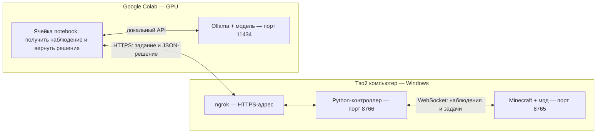

# Minecraft AI Bridge + Ollama в Google Colab: гайд для Windows

Этот гайд и его notebook используют **GPU**. Для **TPU v5e-1** подготовлен [отдельный notebook с vLLM TPU и гайд](VLLM_TPU_COLAB_RU.md). Ollama не поддерживает ускорение на TPU.

В результате модель в Colab получает состояние твоего мира, предлагает действие, а контроллер на Windows отправляет его моду и получает фактический результат. Для первого запуска используем текстовую **Qwen 2.5 7B**; изображения подключим отдельным шагом.

Готовые файлы:

- [Notebook Colab](../examples/ollama_colab.ipynb)
- [Контроллер для Windows](../examples/ollama_colab.py)
- [JAR мода](../releases/minebridge-0.2.0.jar)

## 1. Как это связано



Модель и мод общаются через контроллер: модель выдаёт JSON-решение, а контроллер проверяет его и преобразует в задачу моста. Ollama работает внутри Colab; notebook сам получает задания с твоего компьютера и возвращает ответы. Туннель ngrok запускается **на Windows**.

Colab подходит для интерактивного эксперимента. GPU, продолжительность сессии и допустимые способы использования зависят от [правил Colab](https://research.google.com/colaboratory/faq.html); бесплатная среда может ограничивать внешнее управление и фоновую работу. Этот notebook выполняет ограниченное число решений по запуску ячейки. Для постоянного автономного агента нужна подходящая GPU-среда с разрешённой длительной работой.

## 2. Установи мод и открой мир

1. Установи **Java 25**, **Minecraft 26.1.2** и **NeoForge 26.1.2.97**.
2. Открой [файл JAR](https://github.com/Cloudeah/minebridge/blob/main/releases/minebridge-0.2.0.jar) на GitHub и нажми **Download raw file**.
3. Положи JAR в `mods` своей игровой папки. Для стандартного launcher это `%APPDATA%\.minecraft\mods`. У отдельной сборки/Prism Launcher папку можно открыть из настроек её экземпляра.
4. Запусти именно профиль NeoForge. Для первого опыта создай отдельный плоский одиночный мир.
5. В чате должно появиться `AI Bridge: локальный WebSocket готов; F8 — разрешить управление`.
6. В мире нажми **F3+P**, чтобы **отключить паузу при потере фокуса**. Проверь сообщение игры. Это позволяет пользоваться терминалом/Colab, пока мир продолжает работать. На некоторых клавиатурах нужна также Fn.
7. Оставь игру в оконном режиме, без меню Escape. F8 понадобится перед выполнением действий; F9 — остановка.

После открытия мира появляется `config\minebridge\bridge-owner.json` в игровой папке. Для стандартного launcher полный путь:

```text
C:\Users\ИМЯ\AppData\Roaming\.minecraft\config\minebridge\bridge-owner.json
```

Этот файл читает локальный контроллер. Если ты используешь отдельную сборку, далее подставляй путь её игровой папки.

## 3. Подготовь Python и проект на Windows

1. Установи [Python 3.12](https://www.python.org/downloads/) с Python launcher (`py`).
2. На странице [репозитория](https://github.com/Cloudeah/minebridge) выбери **Code → Download ZIP** и распакуй содержимое проекта в `C:\minebridge`. В этой папке должны лежать `README.md`, `examples`, `python` и `releases`.
3. Открой **PowerShell** и выполни:

```powershell
cd C:\minebridge
py -3.12 --version
py -3.12 -m venv .venv
.\.venv\Scripts\python.exe -m pip install -r python\requirements.txt
```

Дальше запускаем Python полным путём из `.venv`; активация окружения и изменение ExecutionPolicy не требуются. Собирать Java-проект для этого гайда также не нужно.

## 4. Проверь связь Python → мод

В том же PowerShell:

```powershell
.\.venv\Scripts\python.exe examples\client.py --config "$env:APPDATA\.minecraft\config\minebridge\bridge-owner.json" snapshot
```

Ожидаемый результат — JSON с `actor`, `inventory`, `blocks`, `context` и текущими координатами. F8 для снимка не требуется.

Если ошибка `ConnectionRefused`, сначала проверь, что одиночный мир открыт и мод загрузился. Если запрос ждёт и заканчивается timeout — проверь меню Escape и переключатель F3+P. Если `FileNotFoundError` — исправь путь к игровой папке.

## 5. Подготовь Ollama в Colab

1. Открой [Google Colab](https://colab.research.google.com/).
2. Можно попробовать [открыть notebook из GitHub](https://colab.research.google.com/github/Cloudeah/minebridge/blob/main/examples/ollama_colab.ipynb). Если репозиторий закрытый или файл не открылся, скачай `examples/ollama_colab.ipynb` из проекта и выбери в Colab **Файл → Загрузить блокнот**.
3. В Colab: **Среда выполнения → Сменить среду выполнения → T4 GPU** или другой доступный GPU.
4. По порядку выполни **ячейки 1–4** notebook:
   - `nvidia-smi` проверяет наличие GPU;
   - официальный установщик устанавливает Ollama;
   - запускается локальный API Ollama;
   - скачивается `qwen2.5:7b` и проверяется её ответ.
5. В выводе последней ячейки должна быть реплика модели. `ollama ps` показывает загруженную модель и использование CPU/GPU.

Тег `qwen2.5:7b` занимает примерно 4,7 ГБ на диске; контекст и выполнение требуют дополнительной памяти. Если Colab не дал GPU или закончилась память, сначала устрани это. Более лёгкий текстовый вариант — `qwen2.5:3b`: поменяй `MODEL` в ячейке 4 и выполни её снова.

На этом этапе оставь Colab открытым. Ячейки подключения 5–6 запустим после подготовки Windows-контроллера.

## 6. Установи ngrok на Windows

1. Создай аккаунт на [ngrok.com](https://ngrok.com/) и возьми свой **authtoken** в dashboard.
2. Скачай [ngrok для Windows](https://ngrok.com/downloads/windows) и положи `ngrok.exe` в `C:\ngrok`.
3. В PowerShell один раз выполни, подставив свой authtoken:

```powershell
C:\ngrok\ngrok.exe config add-authtoken "ТВОЙ_AUTHTOKEN_NGROK"
```

Доступность HTTPS-endpoint и его лимиты определяются текущим тарифом ngrok. Для notebook потребуется один HTTPS-адрес. Внешний запрос должен содержать relay-токен; локальный Python-сервер проверяет его для каждого запроса.

## 7. Запусти контроллер с первой целью

Вернись в первое окно PowerShell, где открыт `C:\minebridge`, и запусти:

```powershell
.\.venv\Scripts\python.exe examples\ollama_colab.py --config "$env:APPDATA\.minecraft\config\minebridge\bridge-owner.json" --goal "Посмотри на точку на три блока восточнее текущей позиции игрока" --steps 1
```

Он создаст `C:\minebridge\.minebridge-colab.json` и выведет:

```text
Контроллер готов: 127.0.0.1:8766. Токен в .minebridge-colab.json; его значение не выводится.
```

Оставь это окно работающим. Без `--execute` контроллер получает и показывает одно предложение модели. Первый запуск позволяет проверить соединение и формат решения.

Контроллер ждёт обращения Colab до 10 минут. После получения наблюдения на ответ модели отводится 5 минут. Если долго настраивал остальные шаги и он уже завершился, запусти команду снова.

## 8. Открой HTTPS-туннель

Открой **второе окно PowerShell**:

```powershell
C:\ngrok\ngrok.exe http http://127.0.0.1:8766
```

В строке `Forwarding` появится адрес примерно такого вида:

```text
https://your-name.ngrok-free.app -> http://127.0.0.1:8766
```

Скопируй **HTTPS-часть**. Оставь второе окно открытым. Порт здесь **8766**, как у контроллера.

## 9. Передай адрес в Colab и получи решение

1. На Windows открой relay-файл:

   ```powershell
   notepad C:\minebridge\.minebridge-colab.json
   ```

2. В notebook выполни **ячейку 5**. Введи HTTPS-адрес из ngrok. На следующий скрытый запрос вставь значение поля `token` из relay-файла, без кавычек.
3. Ожидаемый ответ: `status: ready`, `protocol: minebridge-colab-1`.
4. Выполни **ячейку 6**, оставив `DECISIONS = 1`.
5. В Colab появится сообщение, что наблюдение получено и модель думает. После ответа — JSON с `action`, `parameters`, `reason`.
6. В первом PowerShell появится тот же предложенный шаг. Команда завершится, поскольку это запуск без выполнения.

Разные токены имеют разные роли:

| Где находится | Кто использует |
| --- | --- |
| `bridge-owner.json` в игровой папке | Контроллер авторизуется в моде |
| `.minebridge-colab.json` в папке проекта | Colab авторизуется в HTTPS-relay |
| Authtoken аккаунта ngrok | ngrok на Windows открывает туннель |

Значения токенов не нужно публиковать в GitHub или сохранять в ячейках notebook. Relay-файл исключён из Git через `.gitignore`.

## 10. Разреши реальное действие

1. Вернись в Minecraft и нажми **F8**. Появится сообщение, что управление разрешено.
2. В первом PowerShell запусти ту же цель с `--execute`:

   ```powershell
   cd C:\minebridge
   .\.venv\Scripts\python.exe examples\ollama_colab.py --config "$env:APPDATA\.minecraft\config\minebridge\bridge-owner.json" --goal "Посмотри на точку на три блока восточнее текущей позиции игрока" --steps 1 --execute
   ```

3. В Colab снова выполни **ячейку 6**. Пока адрес ngrok и relay-файл прежние, повторно вводить токен не требуется.
4. Контроллер отправит предложенное действие моду. Для корректного `look.at` взгляд игрока изменится, а в терминале появится `state: succeeded`.

Решения модели могут быть ошибочными: если она выбрала `wait`, действие не запускается; если мод отказал, терминал покажет причину. `accepted` означает принятие задачи. Фактический итог — `succeeded`, `failed`, `cancelled` или `paused`.

Для опыта с движением в плоском мире:

```powershell
.\.venv\Scripts\python.exe examples\ollama_colab.py --config "$env:APPDATA\.minecraft\config\minebridge\bridge-owner.json" --goal "Пройди пять блоков на восток, сохрани текущую высоту" --steps 1 --execute
```

И ещё раз запусти ячейку 6. На выполнение одной задачи по умолчанию даётся 200 тиков, около 10 секунд работающего мира. Для более длинной задачи можно добавить `--task-ticks 1200` — до 60 секунд.

## 11. Несколько шагов и изображения

### Короткая последовательность

На Windows укажи `--steps 3 --execute`; в Colab поставь `DECISIONS = 3` и запусти ячейку 6. Модель будет получать свежий снимок и итог предыдущего действия перед следующим решением. Контроллер завершает цикл при ошибке, паузе, ручном вмешательстве или `wait`/`finish`. Число — верхняя граница, а не требование выполнить все шаги.

### Добавить RGB-зрение

1. В Colab выгрузи прежнюю текстовую модель, чтобы освободить память:

   ```python
   subprocess.run(["ollama", "stop", "qwen2.5:7b"], check=True)
   ```

2. В ячейке 4 поменяй значение на `MODEL = "qwen2.5vl:3b"` и повтори ячейку.
3. В команду Windows-контроллера добавь `--vision`:

   ```powershell
   .\.venv\Scripts\python.exe examples\ollama_colab.py --config "$env:APPDATA\.minecraft\config\minebridge\bridge-owner.json" --goal "Опиши видимую сцену в reason и выбери wait" --steps 1 --vision
   ```

4. Запусти ячейку 6 в Colab.

Этот пример передаёт PNG 320×180 вместе со структурным наблюдением. Карта глубины доступна в API мода, но этот контроллер не переводит массив float32 в отдельный вход модели. Для текстовой `qwen2.5:7b` используй режим без `--vision`.

## 12. Остановка и повторный запуск

1. **F9 в Minecraft** сразу останавливает управление мода, даже когда модель ещё думает.
2. **Ctrl+C в первом PowerShell** завершает контроллер. При завершении он отменяет свою текущую задачу; разрыв связи также освобождает управление и приостанавливает незавершённые задачи моста.
3. **Ctrl+C во втором PowerShell** закрывает ngrok.
4. В Colab останови выполняющуюся ячейку. Когда закончил эксперимент, выбери отключение/удаление среды выполнения.

Для новой цели при работающем Colab и ngrok достаточно снова запустить Windows-контроллер и ячейку 6. После F9 снова нужен F8. После перезапуска ngrok проверь его адрес и при необходимости повтори ячейку 5. После сброса машины Colab повтори ячейки 1–5.

## Если что-то не работает

| Симптом | Что проверить |
| --- | --- |
| `py` не найден | Установку Python 3.12 и Python launcher |
| Файл владельца не найден | Фактическую игровую папку твоей сборки |
| WebSocket `ConnectionRefused` | Версии мода/NeoForge, открытый одиночный мир, сообщение о готовности |
| Запросы к моду истекают | Пауза Escape, F3+P, игра продолжает ли тикать |
| `permission_denied` при выполнении | F8 после входа в мир/остановки; настройки allowedActions/areas владельца |
| `session_busy` | Другой запущенный клиент/контроллер; закрой его |
| HTTP 401 в Colab | Значение `token` из `.minebridge-colab.json`, без кавычек |
| ngrok 502 | Локальный контроллер запущен и слушает 8766; после одного шага он завершается |
| ngrok сообщает ошибку тарифа/лимита | Account/authtoken, разрешённый endpoint и текущие лимиты ngrok |
| Colab не получает наблюдение | Работающий Windows-контроллер и ngrok, правильный HTTPS-адрес, доступ Colab к нему |
| Нет ответа модели | Ollama API и загруженный MODEL; вывод `/tmp/minebridge-ollama.log`, `ollama ps` |
| Неправильный JSON/неподдержанное действие | Более простую цель и подходящую instruction-модель; контроллер отклоняет такой ответ |
| Модель не принимает изображения | Vision-модель в MODEL и повторную загрузку ячейки 4 |
| `missing_materials` / `missing_tool` | Наличие материалов/выбранного инструмента; крафт 3×3 требует открытого верстака |
| `paused` / ручное вмешательство | Новое наблюдение и новый запуск контроллера; он не возобновляет старый план автоматически |

## Что проверено у разработчика

Мод уже проверен в Minecraft; результаты перечислены в [VALIDATION.md](VALIDATION.md). Дополнительные тесты этого соединения проверяют HTTP-relay, токен, доставку/повтор результатов, ограничения решения и связку контроллер → notebook → API Ollama на локальных тестовых сервисах.

GPU-сессия твоего Colab, реальные ответы выбранной модели и публичный ngrok-туннель в этой разработке не запускались: для них нужны твой Google/Colab runtime и аккаунт ngrok. Успешный локальный тест не является проверкой этих внешних сервисов.

Официальные справочники: [Ollama chat API](https://docs.ollama.com/api/chat), [структурированные ответы](https://docs.ollama.com/capabilities/structured-outputs), [зрение](https://docs.ollama.com/capabilities/vision), [Qwen 2.5](https://ollama.com/library/qwen2.5), [Qwen 2.5 VL](https://ollama.com/library/qwen2.5vl), [правила Colab](https://research.google.com/colaboratory/faq.html), [ngrok](https://ngrok.com/docs).
