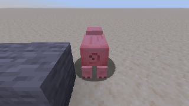

# Проверки реализации 0.1.0

Дата: 10 октября 2026. Проверено в текущей облачной среде: Linux x86_64, JDK 25, Minecraft **26.1.2**, NeoForge **26.1.2.97**. Носитель — существующий игрок в одиночном мире. Графический dev-клиент запускался под Xvfb с Mesa llvmpipe; это не измерение производительности игрового компьютера.

## Автоматические проверки

```bash
python scripts/bootstrap.py
python scripts/dev.py :core:test :mod:build
.venv/bin/python -m unittest discover -s python -p 'test_*.py'
```

Сборка завершилась успешно. Выполнены **46 Java-тестов и 3 Python-теста**, без ошибок, пропусков или отключённых тестов. Повторный bootstrap и сборка также прошли.

| Набор | Количество | Что проверяет |
| --- | ---: | --- |
| BridgeEngineTest | 25 | Авторизация, разрешение владельца, actor/revision, принятие и итог задачи, дедупликация, отмена, ручная пауза, разрыв связи, зависимости, срок/бюджет, история, смерть, неверный и глубоко вложенный JSON |
| PlannerTest | 15 | Обход препятствия, неизвестные чанки, ограничение поиска, цепочки крафта, альтернативы, нехватка, циклы, станции и остатки, поворот и порядок чертежа |
| MemoryVisionTest | 5 | Сохранение и изоляция памяти, токен, бинарная раскладка пакета, NaN глубины и обратная проекция |
| SocketTest | 1 | Настоящее локальное WebSocket-соединение, hello, авторизация и снимок через Java HTTP/WebSocket клиент |
| Python decoder | 3 | Разбор MBV1, глубина little-endian, отклонение неправильного и обрезанного пакета |

JAR содержит NeoForge metadata, классы ядра и клиента, ресурсы клавиш и вложенный Java-WebSocket. Итоговый файл: `mod/build/libs/minebridge-0.1.0.jar`. GitHub Actions настроен, но удалённый запуск CI в этой сессии не выполнялся.

## Проверки в работающем Minecraft

Мир `BridgeSmoke`: плоский, одиночный, мирные условия. Исходные предметы и неподвижная тестовая свинья подготовлены игровыми командами **только как тестовые данные**. Проверяемые действия выполнял мост в режиме выживания через штатные действия клиента и серверные пакеты; исполнитель не вызывает выдачу предметов, телепортацию или прямую замену блоков.

| Сценарий | Результат |
| --- | --- |
| Подключение и наблюдение | Hello/authenticate, capabilities, реальные координаты, предметы, блоки и открытое меню получены через Python SDK |
| Взгляд и маршрут | Взгляд на координаты/сущность и движение к точке закончились в заданном допуске |
| Добыча/размещение | Камень размещён из hotbar, затем добыт железной киркой; сервер подтвердил блок и последующий воздух |
| Выбор hotbar | Сервер подтвердил выбранный слот |
| Точный перенос | Два бревна перенесены между слотами; проверены оба количества и пустой курсор |
| Крафт | Цепочка «бревно → дубовые доски → 4 палки» завершена; выход и оставшиеся доски подтверждены сервером |
| Строительство | Два соседних каменных блока подтверждены; существующая часть пропущена после проверки, для закрытой опоры выполнен подход с другой позиции |
| Контейнер | Сундук размещён и открыт; ровно две палки перенесены в него; команда с устаревшим menu_revision отклонена; контейнер закрыт |
| Зрение | Получены PNG 320×180 и 57 600 float32 значений глубины, камера и связанный снимок; один из кадров содержит реальную свинью с совпадающим entity_id и экранной областью |
| Отмена в бою | После одного удара задача cancelled; в результате серверное здоровье цели 4; спустя 0,8 с число атак не увеличилось |
| Завершение боя | Следующая задача подтвердила поражение той же цели на сервере |
| Повтор запроса | Повтор task.submit до и после переподключения вернул исходный task_id |
| Разрыв связи | Движение остановилось; после подключения задача осталась paused и не продвигалась до task.resume; затем завершилась |
| Остановка | control.stop освободил управление; для дальнейших действий потребовался F8 |
| Смена/закрытие мира | Закрытие с сохранением и повторный запуск мира прошли без исключения мода; управление новой сессии изначально выключено |

Пример нативного кадра до боя, без HUD:



У этого кадра время от подготовки метаданных до постановки закодированного пакета в очередь составило 59 мс. Это единичное наблюдение, не обещание задержки: синхронное чтение framebuffer, кодирование, транспорт и внешняя модель требуют отдельного измерения под нагрузкой.

## Границы проверок

Запуск выполнен через NeoForge dev-loader. Установка собранного JAR в отдельный пользовательский launcher, выделенный сервер, сторонние сборки, шейдеры и стресс-проверка медленного получателя не выполнялись. Поведение восстановления/истории проверено тестами ядра и живым переподключением; количественные пределы задержки при сетевой перегрузке не измерены.

В живой игре не проверялись каждый vanilla-рецепт, остатки в 3×3 верстаке, все ориентации/многоблочные блоки, экипировка, длительное использование предметов, смена измерения и смерть игрока. Где применимо, алгоритмы и состояние задач покрыты тестами ядра, а не игровым сценарием. Неподдержанные механики перечислены в README и не объявляются в capabilities.

Эти результаты подтверждают рабочий контур первой реализации. Они не означают завершённую приёмку любой модовой сборки или всех сценариев документа.

## Дополнение: контроллер Ollama / Colab

Для [гайда Windows + Colab](OLLAMA_COLAB_RU.md) добавлены HTTP-relay, локальный контроллер и notebook. Общий Python-набор теперь содержит **13 тестов**: три проверки MBV1 и десять проверок нового соединения.

Проверены авторизация relay, доставка/повтор ответа и отказ устаревшему заданию, ошибка модели, повторное использование токена, отклонение недоступного действия/NaN, прекращение ожидания при остановке. Три интеграционных сценария запускают код ячейки notebook против локального HTTP API с фиксированным ответом модели и настоящего WebSocket тестового сервера: предложение без выполнения, выполнение задачи с чтением результата, передача PNG.

Эти сценарии проверяют соединение компонентов. Они не запускают нейросеть, Windows, GPU Colab или публичный ngrok-туннель и не доказывают качество решений модели. Java-код и опубликованный JAR при добавлении гайда не менялись.

## Дополнение: notebook vLLM TPU / Colab

Добавлены [vLLM TPU notebook](../examples/vllm_tpu_colab.ipynb), [Windows-контроллер](../examples/vllm_colab.py) и [гайд](VLLM_TPU_COLAB_RU.md). Проверены исходники wheel релизов `vllm-tpu==0.31.0` и `tpu-inference==0.31.0`: Python 3.12, имя JAX backend `flax_nnx`, аргументы сервера и протокол `/tokenize`.

Общий Python-набор теперь содержит **28 тестов**. Дополнительно проверены:

- сокращённое наблюдение с сохранением инвентаря, номеров слотов и menu revision;
- код функций именно опубликованного notebook против локального HTTP API vLLM и настоящего WebSocket тестового сервера: предложение, выполнение и чтение результата, передача исходных PNG-байтов, ошибка модели без игровой задачи;
- отклонение превышенного контекста до генерации, недоступного действия, NaN, неправильного JSON и обрезанного ответа;
- сериализация опциональной JSON-схемы в OpenAI-формат;
- повтор доставки с тем же job_id без новой генерации и отказ истёкшему заданию после медленного ответа модели;
- отсутствие relay-токена в запросе к модели и её HTTP-заголовках;
- запуск ячеек проверки и сервера с имитацией устройств JAX: доступность CPU для подготовки весов, TPU как backend по умолчанию, отказ при отсутствии CPU/TPU или нескольких TPU, передача проверенного окружения серверу и флага `--disable-chunked-mm-input`.

Исправлена ошибка из предоставленного журнала Colab: `Unknown backend cpu. Available backends are ['tpu']`. При `JAX_PLATFORMS="tpu"` загрузчик `tpu-inference==0.31.0` вызывал `cpu_mesh_context()` → `jax.devices("cpu")` при преобразовании весов и завершался до запуска API. Notebook теперь задаёт `JAX_PLATFORMS="tpu,cpu"` и проверяет CPU в отдельном процессе до запуска модели. Это исправление конфигурации подтверждено исходниками релизного wheel и локальной проверкой; полный повторный запуск на пользовательском TPU ещё требуется.

Проверены синтаксис ячеек и отсутствие сохранённых выводов/токенов. Дополнительно официальный tokenizer и chat template Gemma 4 E2B IT использованы на CPU с синтетическими наблюдениями, соответствующими полям мода: простой снимок — 1251 входной токен; четыре сущности с UUID и два предмета — 1731; с предыдущим результатом — 1872. С резервом 256 токенов ответа последний вариант превышает 2048, поэтому начальный контекст notebook установлен в 3072. Это проверка отдельных примеров, не гарантия вместимости любого наблюдения; перед каждым запросом используется `/tokenize` сервера.

Тестовый API возвращает фиксированные ответы; он не запускает нейросеть. Загрузка весов, работа vLLM на реальном TPU v5e-1, компиляция JAX, предел памяти/скорость и публичный ngrok не проверялись в текущей среде, где TPU отсутствует. Мод и опубликованный JAR при этой работе не менялись.
