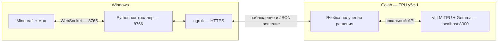

# Minecraft AI Bridge + vLLM TPU в Colab: гайд для Windows

Готовый [notebook](../examples/vllm_tpu_colab.ipynb) запускает **Gemma 4 E2B IT** через **vLLM TPU**. Minecraft и [Python-контроллер](../examples/vllm_colab.py) работают на Windows. Colab получает наблюдение через HTTPS и возвращает JSON-решение; контроллер проверяет его, выполняет действие и читает результат мода.

Для ввода целей через **F7 в Minecraft** используй [гайд управления из игры](INGAME_VLLM_RU.md). Ниже описан запуск отдельной цели из PowerShell и проверка без выполнения.



Для первого опыта используются текстовые наблюдения. Изображения включаются после проверки основного соединения. Для Colab это интерактивный эксперимент; доступность TPU, время сессии и допустимые сценарии зависят от [правил Colab](https://research.google.com/colaboratory/faq.html).

## 1. Подготовь Windows

1. Установи **Java 25**, **Minecraft 26.1.2**, **NeoForge 26.1.2.97**.
2. Открой [готовый JAR](https://github.com/Cloudeah/minebridge/blob/main/releases/minebridge-0.2.1.jar), нажми **Download raw file** и положи его в `mods` своей игровой папки. Для стандартного launcher это `%APPDATA%\.minecraft\mods`.
3. Запусти профиль NeoForge и открой одиночный мир. Проверь сообщение о готовности AI Bridge. Нажми **F3+P**, чтобы отключить паузу при потере фокуса, и оставь мир без меню Escape.
4. Установи [Python 3.12](https://www.python.org/downloads/) с Python launcher `py`.
5. Скачай свежий **Code → Download ZIP** из [репозитория](https://github.com/Cloudeah/minebridge), распакуй в `C:\minebridge`. Здесь должны быть папки `examples`, `python` и `releases`.
6. В первом PowerShell:

```powershell
cd C:\minebridge
py -3.12 -m venv .venv
.\.venv\Scripts\python.exe -m pip install -r python\requirements.txt
.\.venv\Scripts\python.exe examples\client.py --config "$env:APPDATA\.minecraft\config\minebridge\bridge-owner.json" snapshot
```

Последняя команда должна показать JSON состояния мира. Если у тебя отдельная сборка или launcher, подставь её путь к `config\minebridge\bridge-owner.json` во всех следующих командах.

7. Создай аккаунт [ngrok](https://ngrok.com/), скачай Windows-версию в `C:\ngrok` и добавь authtoken из dashboard:

```powershell
C:\ngrok\ngrok.exe config add-authtoken "ТВОЙ_AUTHTOKEN_NGROK"
```

Доступность HTTPS-endpoint и его лимиты зависят от тарифа ngrok. Для notebook нужен один HTTPS-адрес Windows-контроллера.

## 2. Открой notebook и запусти модель

1. Открой [vllm_tpu_colab.ipynb на GitHub](https://github.com/Cloudeah/minebridge/blob/main/examples/vllm_tpu_colab.ipynb) и нажми **Download raw file**.
2. В [Google Colab](https://colab.research.google.com/) выбери **Файл → Загрузить блокнот** и загрузи скачанный `.ipynb`. Этот способ работает также с закрытым репозиторием.
3. Выбери **Среда выполнения → Сменить среду выполнения → TPU v5e-1**.
4. Выполни шаги **1–4** notebook по порядку:
   - установка создаёт отдельное окружение Python 3.12 и устанавливает `vllm-tpu==0.31.0`;
   - короткий процесс проверяет один TPU и CPU backend для загрузки весов, затем освобождает TPU;
   - запускается локальный сервер vLLM и скачивается модель;
   - выполняется генерация тестового JSON-ответа.
5. После шага 4 должен появиться JSON с `action: wait` и `reason`. Это результат реального запроса к модели, без управления Minecraft.

Не запускай `jax.devices()` в ядре notebook перед сервером. TPU проверяется отдельным процессом, чтобы ядро не удерживало чип. Повторять шаг 2 при работающем сервере также не нужно.

В шаге 2 установлено `JAX_PLATFORMS = "tpu,cpu"`: модель выполняется на TPU, а CPU используется для подготовки весов. Не меняй значение на `"tpu"`, иначе загрузчик завершится с `Unknown backend cpu`.

Первый запуск включает скачивание весов и компиляцию JAX. Сервер ждёт готовность до 30 минут и печатает сообщения ожидания. При ошибке открой `/tmp/minebridge-vllm-tpu.log` через панель файлов Colab. Веса Gemma 4 E2B IT доступны публично; аккаунт OpenAI и его API-ключ не нужны.

Начальные параметры: BF16, один запрос за раз, контекст 3072 токена, ответ до 256 токенов, `ENABLE_VISION = False`. Такой контекст оставляет место для инструкций, UUID сущностей и результата предыдущего действия. Сведения о памяти и выборе модели — в [TPU_MODEL_RU.md](TPU_MODEL_RU.md). Если меняешь параметры сервера, сначала выполни его остановку в шаге 7 notebook, затем повтори шаги 3–4.

## 3. Запусти контроллер и HTTPS-туннель

Вернись в первое окно PowerShell:

```powershell
cd C:\minebridge
.\.venv\Scripts\python.exe examples\vllm_colab.py --config "$env:APPDATA\.minecraft\config\minebridge\bridge-owner.json" --goal "Посмотри на точку на три блока восточнее текущей позиции игрока" --steps 1
```

Без `--execute` контроллер показывает одно предложение. Он создаст файл `.minebridge-colab.json` и сообщит о готовности на `127.0.0.1:8766`. Оставь терминал работающим.

Во втором PowerShell:

```powershell
C:\ngrok\ngrok.exe http http://127.0.0.1:8766
```

Скопируй HTTPS-адрес из строки `Forwarding`, например `https://your-name.ngrok-free.app`. Туннель запускается на Windows; сервер vLLM внутри Colab остаётся локальным.

В третьем окне PowerShell открой relay-файл:

```powershell
notepad C:\minebridge\.minebridge-colab.json
```

Теперь выполни **шаг 5 notebook**: введи HTTPS-адрес ngrok и значение поля `token` из этого файла, без кавычек. Ввод токена скрыт. Ожидаемый результат — `status: ready`, `protocol: minebridge-colab-1`.

Токены имеют разные роли:

| Файл/настройка | Кто использует |
| --- | --- |
| `bridge-owner.json` в игровой папке | Windows-контроллер подключается к моду |
| `.minebridge-colab.json` в папке проекта | Colab подключается к HTTPS-relay |
| Authtoken ngrok | ngrok на Windows создаёт туннель |

Значения не сохраняй в исходный код notebook или GitHub. Relay-файл исключён из Git. Контроллер ждёт первого запроса до 10 минут; если успел завершиться, запусти Windows-команду повторно.

## 4. Получи предложение, затем выполни действие

1. Выполни **шаг 6 notebook** с `DECISIONS = 1`. Появится JSON с `action`, `parameters`, `reason`; Windows-контроллер покажет то же предложение и завершится.
2. Убедись, что предложенное действие соответствует цели. Первая команда не выполняет игровые задачи.
3. Для выполнения вернись в Minecraft и нажми **F8**.
4. В первом PowerShell запусти:

```powershell
.\.venv\Scripts\python.exe examples\vllm_colab.py --config "$env:APPDATA\.minecraft\config\minebridge\bridge-owner.json" --goal "Посмотри на точку на три блока восточнее текущей позиции игрока" --steps 1 --execute
```

5. Повтори **шаг 6 notebook**. Адрес и токен прежние; шаг 5 повторять не нужно, если ngrok не перезапускался.
6. Контроллер проверит решение, отправит задачу и прочитает результат. При успешном `look.at` взгляд изменится, а в PowerShell появится `state: succeeded`.

`accepted` означает принятие задачи; фактический итог — `succeeded`, `failed`, `cancelled` или `paused`. При `wait`/`finish`, ошибке или остановке новый игровой шаг не запускается автоматически. **F9 в игре немедленно останавливает управление**, даже если модель ещё думает.

Контроллер TPU отправляет шесть ближайших блоков, четыре сущности, последний результат и непустые слоты меню плюс до четырёх пустых. Исходные номера слотов сохраняются. Отсутствующие данные означают неизвестность. Если задача требует больше сведений, модель может выбрать `wait`.

## 5. Несколько шагов и скриншоты

Для короткой последовательности укажи `--steps 3 --execute` на Windows и `DECISIONS = 3` в notebook. Перед каждым решением модель получает новое наблюдение и фактический итог предыдущего действия. Число — верхняя граница, цикл может завершиться раньше.

Для RGB-зрения:

1. В Colab выполни **шаг 7**, чтобы остановить сервер.
2. В шаге 3 поставь `ENABLE_VISION = True` и повтори **шаги 3–4**. `MODEL` оставь `google/gemma-4-E2B-it`. Сервер разрешит одно изображение; начальный бюджет изображения — 140 визуальных токенов.
3. На Windows сначала проверь предложение без выполнения:

```powershell
.\.venv\Scripts\python.exe examples\vllm_colab.py --config "$env:APPDATA\.minecraft\config\minebridge\bridge-owner.json" --goal "Опиши видимую сцену в reason и выбери wait" --steps 1 --vision
```

4. Повтори **шаг 5** подключения notebook, если выполнял ячейку остановки: она закрывает HTTP-сессии. Затем запусти **шаг 6**.

Передаётся PNG 320×180 вместе со структурным наблюдением. Карта глубины не подаётся в эту модель. Изображение занимает часть общего контекста; если бюджет превышен, запрос не отправляется на генерацию.

## 6. Остановка и новая цель

1. **F9 в Minecraft** останавливает управление.
2. **Ctrl+C** в терминале Windows-контроллера завершает его. Разрыв связи освобождает управление и приостанавливает незавершённые задачи моста.
3. **Ctrl+C** в терминале ngrok закрывает туннель.
4. **Шаг 7 notebook** завершает запущенный им сервер вместе с дочерними процессами и закрывает HTTP-сессии.
5. Для полного завершения выбери **Среда выполнения → Отключиться и удалить среду выполнения**.

Для новой цели при работающих vLLM и ngrok достаточно перезапустить Windows-контроллер и шаг 6 notebook. После F9 снова нужен F8. После остановки сервера повтори шаги 3–5. После сброса машины Colab повтори установку.

## 7. Если что-то не работает

| Симптом | Что проверить |
| --- | --- |
| `py` / `ngrok` не найден | Установку Python launcher и путь к `ngrok.exe` |
| WebSocket не подключается | Мир открыт, профиль NeoForge и версии верны, путь к `bridge-owner.json` правильный |
| Запросы мода истекают | Мир продолжает тикать, меню Escape закрыто, F3+P отключил паузу при потере фокуса |
| Проверка TPU завершилась ошибкой | Выбран v5e-1; в ядре/другом процессе не удерживается TPU. При необходимости сбрось среду |
| Установка пакетов не проходит | Интернет, свободный диск, отдельный Python 3.12. Используй закреплённый релиз; обновление JAX отдельно может нарушить совместимость |
| `Unknown backend cpu. Available backends are ['tpu']` | Обнови notebook: в шаге 2 должно быть `JAX_PLATFORMS = "tpu,cpu"`. Выполни шаг 7 для остановки старого сервера, затем шаги 2–4. Если ядро уже импортировало JAX, сначала перезапусти сессию Colab и выполни шаги 1–4 |
| vLLM завершился / память TPU закончилась | Журнал `/tmp/minebridge-vllm-tpu.log`, отсутствие других TPU-процессов; начни с `ENABLE_VISION = False` и одной последовательности. Можно уменьшить контекст до 2048 для простой цели или выбрать меньший по памяти текстовый `Qwen/Qwen3-4B` и повторить запуск сервера |
| Порт 8000 занят | Остановку собственного сервера в шаге 7; если запущен другой сервер, освободи его или сбрось Colab |
| HTTP 401 в Colab | Полное значение `token` из `.minebridge-colab.json` |
| ngrok 502 | Контроллер работает на 8766; после одного решения он завершается, перед следующим нужен новый запуск |
| `Контекст слишком длинный` | Более короткую цель; можно увеличить `MAX_MODEL_LEN` до 4096 и перезапустить сервер, если хватает памяти |
| `Expecting ',' delimiter` / неверный JSON | Обновлённый notebook требует вычисленные числовые координаты, показывает ответ модели и делает одну повторную генерацию. [Обновление адаптера в текущей сессии](INGAME_VLLM_RU.md#8-если-модель-вернула-неправильный-json). Если обе попытки не прошли, сохрани вывод «Ответ модели» |
| Ответ не завершён | Короткий `reason` и достаточный `MAX_NEW_TOKENS`; адаптер повторяет генерацию один раз, обрезанный ответ не становится действием |
| Изображение отклонено | `ENABLE_VISION = True`, перезапуск сервера и `--vision` на Windows |
| Нет решения за отведённое время | Готовность сервера и тёплый запуск шага 4; TPU-контроллер ждёт решение до 900 секунд |
| `permission_denied` / `paused` | F8 после остановки; ручной ввод и меню могут приостановить задачу. Для нового действия нужен новый запуск |

Notebook по умолчанию задаёт JSON-схему в инструкции и проверяет ответ. `USE_STRUCTURED_OUTPUTS = True` использует строгую генерацию по схеме через vLLM, но её TPU-поддержка помечена разработчиками плагина как непроверенная. Для первого запуска оставь `False`.

Проверены локальные HTTP/WebSocket-соединения, код ячеек адаптера, PNG, ошибки и отклонение устаревшего ответа; подробности в [VALIDATION.md](VALIDATION.md). Реальная загрузка модели, компиляция на TPU v5e-1, Colab и публичный туннель в этой среде не выполнялись. Эти проверки нужно пройти на твоём runtime.

Источники: [vLLM TPU quickstart](https://docs.vllm.ai/projects/tpu/en/latest/getting_started/quickstart/), [модели TPU-плагина](https://docs.vllm.ai/projects/tpu/en/latest/recommended_models/), [OpenAI-совместимый API vLLM](https://docs.vllm.ai/en/latest/serving/online_serving/), [релиз vllm-tpu 0.31.0](https://pypi.org/project/vllm-tpu/0.31.0/), [Gemma 4 E2B IT](https://huggingface.co/google/gemma-4-E2B-it).
